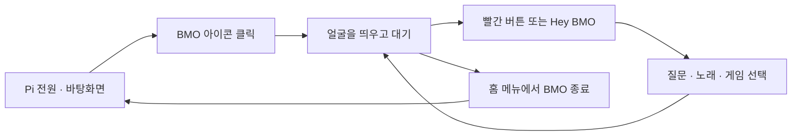

# BMO AI Robot

**필요할 때 켜서, 부르고, 이야기하고, 함께 노는 BMO.**

[English](README.md) · **한국어** · [레퍼런스·게임 후보·노래 조사](docs/BMO_REFERENCES_KR.md)

> 큰 BMO를 갖고 싶어서 시작했습니다. 7인치 화면에 맞춰 외형을 직접 설계했고, 이제 기존 얼굴·음성 코드를 연결해 하나의 캐릭터로 만들어 갑니다.
>
> **2026-10-17 갱신:** 아래는 최신 사용자 요구를 반영한 작동 계획입니다. 테스트 통과, 실물 동작, 사용자의 최종 승인은 서로 다릅니다. 이전 데모를 실행했다는 이유로 얼굴·목소리·전체 제품이 승인됐다고 표시하지 않습니다.

<p align="center">
  
  <br />
  <sub>원작 외형을 참고해 약 135% 크기로 다시 설계한 본체</sub>
</p>

[사용 흐름](#bmo를-켜서-끄기까지) · [대화 방식](#버튼으로도-hey-bmo로도) · [버튼](#누르기-편한-버튼-배치) · [표정과 팔](#얼굴과-팔로-반응하기) · [현재 상태](#현재-상태와-다음-작업) · [제작 자료](#제작-자료)

## BMO를 켜서 끄기까지

라즈베리파이는 개인 웹서버로도 사용할 수 있도록 계속 켜 둡니다. **BMO는 부팅 때 자동으로 시작하지 않고, 바탕화면의 BMO 아이콘을 눌러 따로 실행**하는 방향입니다. 실행하면 얼굴이 계속 대기하고, 질문·노래·게임을 마친 뒤에도 다시 그 얼굴로 돌아옵니다.



이 그림은 **목표 동작**입니다. BMO를 종료하면 녹음·재생·게임 등 BMO가 시작한 작업만 정리하고 바탕화면으로 돌아갑니다. **Pi 전원, 팬, SSH, 다른 웹서버는 유지**합니다. 아이콘을 여러 번 눌러도 앱은 하나만 실행되어야 합니다.

## 버튼으로도, “Hey BMO”로도

**대화의 입구는 두 개, 들어간 뒤의 처리는 하나**로 설계합니다. 빨간 버튼은 언제나 쓸 수 있는 확실한 입력이고, “Hey BMO!”는 손을 쓰지 않고 부르는 방법입니다. 호출어를 지원 범위에서 빼지 않습니다.

대기 중 호출어를 사용하도록 설정하면 Pi가 마이크 신호를 **로컬에서** 확인합니다. 부르기 전 주변 소리를 계속 클라우드 STT에 보내는 방식은 아닙니다. BMO 앱을 끄거나 호출어를 비활성화하면 이 감지도 멈춥니다. 호출어만 켜도 마이크는 로컬 처리에 쓰인다는 점은 화면에 표시합니다.

> **빨강 또는 “Hey BMO” → 녹음 준비 표시 → 질문 → 말 끝 감지 → 인식·생각 → 답변 재생과 입 동작 → 대기**

“Hey BMO, 오늘 뭐 할까?”처럼 이어 말할 때 앞부분이 잘리지 않도록 같은 오디오 흐름과 짧은 메모리 버퍼를 사용하고, 버튼과 호출어가 겹쳐도 한 번만 시작하게 합니다. 기존 `wakeword.onnx`의 대상 문구·출처·성능부터 확인하며, 파일이 있다는 이유만으로 “Hey BMO”를 잘 인식한다고 가정하지 않습니다.

말 끝은 VAD로 감지하고 빨강을 다시 눌러 직접 제출할 수도 있습니다. **생각하거나 말하는 중 빨강은 현재 작업을 중단**합니다. 준비 표시가 나온 뒤 다음 누름으로 새 질문을 시작하며, 첫 중단 버튼이 곧바로 녹음을 켜지는 않습니다.

**음악·게임·BMO 자신의 발화 중에는 호출어를 기본적으로 쉬게** 합니다. 이때는 빨강으로 멈추거나 일시정지합니다. 자기 목소리를 다시 질문으로 받는 문제를 피하고, 완전한 음성 끼어들기는 별도 검증 후 추가합니다.

BMO가 “어떤 게임?”처럼 사용자에게 선택을 물었을 때만 짧게 답을 기다리는 후속 듣기를 검토합니다. 모든 대답 뒤 자동으로 마이크를 여는 방식은 기본으로 삼지 않습니다. 시끄러운 전시 장소에서는 호출어를 끄고 빨간 버튼만 사용할 수 있게 합니다.

<details>
<summary>대화 레퍼런스와 아직 조정할 값</summary>

[Be More Agent](https://github.com/brenpoly/be-more-agent)의 호출어·상태별 얼굴/효과음 분리, [Home Assistant의 음성 파이프라인](https://contributors.home-assistant.io/architecture/platform/voice/)과 [버튼/호출어를 같은 흐름으로 받는 구조](https://contributors.home-assistant.io/core/entities/assist-satellite/)를 참고했습니다. 해당 프로젝트의 로컬 LLM이나 홈 자동화 전체를 가져오는 것은 아닙니다. BMO의 지능은 기존 클라우드 GPT를 유지합니다.

[openWakeWord](https://github.com/dscripka/openWakeWord)는 호출어와 VAD를 구분하고 환경별 오인식/누락 검사를 권장합니다. 엔진 후보이지 최종 선택이나 실제 성능 승인은 아닙니다. “헤이 비모”의 한국어 억양·거리·배경 대화에서도 별도로 확인합니다.

초기 후보는 말 시작 대기 3초, 발화 후 무음 0.9초, 녹음 최대 10초입니다. 모두 조정 가능한 제안값이며, 불안정하면 버튼 시작/버튼 종료를 사용합니다. 호출어 준비 버퍼가 음성 인식에 어느 범위까지 포함되는지도 검사합니다. 후속 선택 대기는 화면에 명확히 표시하고 무응답이면 대기로 돌아갑니다.

취소는 로컬 재생 정지와 원격 요청 취소를 구분합니다. 취소 후 늦게 도착한 답변은 말하지 않으며, 이미 시작된 요청의 과금까지 취소됐다고 표시하지 않습니다.

</details>

## 누르기 편한 버튼 배치

**바깥쪽의 초록 원을 확인·선택으로, 파란 세모를 뒤로·취소로 쓰는 것을 권장**합니다. 가장 자주 누를 확인을 편한 위치에 두고, 빨강은 대화 역할을 유지합니다. 색·모양보다 실제 조작 편의가 기준이며 최종 배치는 직접 눌러 보고 확정합니다.

| 버튼 | BMO·메뉴에서 | 게임에서의 권장 역할 |
|---|---|---|
| **십자** | 항목 이동 | 이동 |
| **작은 초록 원** | 메뉴 열기·확인·선택 / 노래 재생·일시정지 | A: 주 행동·점프 |
| **파란 세모** | 뒤로·취소 / 길게 누르면 홈 | B: 보조 행동 / 길게 누르면 홈 탈출 |
| **빨간 원** | 질문 시작·녹음 제출·현재 답변 중단 | 일시정지. 게임 중 바로 녹음하지 않음 |

파란 세모 길게 → 홈 → 시스템 → **BMO 종료** → 초록 확인으로 닫는 안입니다. Pi 전체 종료는 이 버튼의 즉시 동작에 넣지 않습니다. 노래/게임에서 질문하려면 먼저 재생을 멈추고 준비 상태로 전환합니다.

기존 기록의 초록=Enter, 세모=Z는 앱에서 의미별로 매핑할 수 있습니다. **빨간 GP7의 기존 팔 토글은 별도 충돌**이므로 질문 버튼 연결 전에 펌웨어와 확인해야 합니다. 이번 문서 갱신으로 실제 버튼이나 펌웨어가 바뀐 것은 아닙니다. 게임에서 길게 누르기가 B 입력과 겹치는 조작감도 검수합니다.

## 얼굴과 팔로 반응하기

**이미 만든 얼굴을 다시 그리지 않습니다.** 선호했던 v2의 비율·색·표정을 기준으로, v3의 부드러운 윤곽과 오디오 기반 입 움직임을 재사용합니다. 다만 기존 v3의 움직임까지 사용자가 최종 승인한 것은 아니므로, 한 표정을 충분히 오래 보면서 수정할 수 있는 미리보기가 필요합니다.

듣기·생각하기·깜빡임은 미리 만든 **로컬 무음 애니메이션**입니다. 짧은 인사·확인 안내는 준비된 클립을 사용할 수 있고, 새로운 질문은 GPT가 답합니다. 일반 대화를 대충 비슷한 예전 답으로 대체하지 않습니다. 같은 응답을 다시 들을 때만 현재 세션의 오디오 캐시를 재생합니다.

**팔은 이번 통합 범위에 포함하고, IMU는 따로 보류**합니다. 양팔의 과거 작동 확인 이력은 보존하되, 새 연출의 각도·속도·타이밍과 사용자의 만족도는 아직 확인할 사항입니다.

| 장면 | 얼굴과 팔의 권장 연출 |
|---|---|
| 처음 인사 | 웃는 얼굴 + **BMO 자신의 오른팔을 한 번 들어 인사** |
| 기뻐하거나 성공했을 때 | 행복한 얼굴 + **양팔을 들어 만세** |
| 모른다고 답할 때 | 곤란한 얼굴 + 양팔을 작게 들어 으쓱하는 느낌 |
| 듣기·생각하기 | 얼굴만 움직이고 팔은 쉬기 |

팔은 문장마다 반복하지 않고 의미 있는 장면에서 한 번만 연기합니다. 정해진 이름의 제스처를 사용하며 GPT가 임의 각도나 PWM을 보내지는 않습니다. 기존 기구에서 확인한 동작 범위를 재사용하되 새 제스처가 충돌하지 않는지 확인합니다. 팔이 한 축씩인 구조에 손목 흔들기 같은 존재하지 않는 자유도를 가정하지 않습니다.

**IMU가 없거나 불량이어도 팔 기능 전체를 막는 설계는 하지 않습니다.** 현재는 사람이 안정되게 놓인 상태에서 팔을 쓰고, 들고 이동할 때는 팔 동작을 끄는 방식으로 다룹니다. 자동 들림/기울어짐 반응은 IMU 정상성 확인 이후입니다. 앱 종료·재연결 때 무조건 팔을 끝까지 이동시키는 동작도 넣지 않습니다.

## 노래와 게임

### 노래는 로컬에서 바로 재생

“노래해 줘”라고 하면 등록된 노래를 고르고, 특정 제목을 말하면 해당 곡을 재생하는 방향입니다. 매번 유튜브를 열거나 TTS로 다시 노래를 만들지 않고, **미리 준비한 로컬 음원과 입 동작**을 사용합니다. 다운로드 대기와 새 합성 과정은 없앨 수 있지만 실제 재생 지연은 별도로 측정합니다.

**이전의 2곡 제한은 없앱니다.** 원작에서 BMO가 직접 부른 곡을 가능한 한 빠짐없이 모으는 것이 목표입니다. 다만 BMO가 부른 곡, BMO가 틀어 놓은 다른 가수의 곡, 리믹스·팬 커버는 구분합니다. [확인한 곡과 출처](docs/BMO_REFERENCES_KR.md#노래--곡수-제한-없이-원작-목록부터)를 정리했으며, 목록 확인과 파일 확보는 다릅니다.

현재 음원 추출·다운로드·Pi 등록은 하지 않았습니다. 파일은 사용 가능한 경로로 확보하고, 전시/공개 영상에서의 이용 조건을 확인합니다. 원작 음원·가사·영상은 이 저장소에 통째로 올리지 않습니다. 음원 준비 뒤 볼륨·앞뒤 무음·곡과 입 타임라인을 맞춥니다.

### 게임은 급하게 만들지 않고 먼저 고르기

“게임 하고 싶어” → 게임 목록 → 십자로 이동 → **초록으로 시작** → 빨강으로 일시정지 → 파란 세모로 뒤로/홈. 게임이 끝나면 BMO 얼굴로 돌아옵니다.

기존 팬 게임을 우선 검토합니다. [Virtual BMO와 Guardians of Sunshine 비교·직접 해 볼 링크](docs/BMO_REFERENCES_KR.md#게임--사용자가-먼저-해볼-후보)는 별도 조사 메모에 모았습니다. 게임을 새로 만들거나 지금 설치하지 않으며, 사용자가 재미·조작을 확인한 뒤 채택합니다. 게임 개수도 이전 초안의 2종을 최종 승인된 제한으로 취급하지 않습니다.

## 내부 구조는 이렇게 연결

복잡한 기능마다 프로그램을 하나씩 더 만드는 대신, **기존 Python 백엔드가 흐름을 관리하고, v3 얼굴·단일 음성 재생·팔 제스처를 함께 지휘**하게 합니다.

```text
빨간 버튼 / 로컬 Hey BMO 감지
             ↓
    하나의 대화·메뉴 관리자
       ├─ 새로운 질문 → 클라우드 GPT → 선택한 TTS
       └─ 반복 연출·노래·게임 → 등록된 로컬 콘텐츠
             ↓
      얼굴 + 하나의 재생 경로 + 팔
             ↓
            대기

팬·SSH·개인 웹서버는 BMO 앱 밖에서 독립 유지
IMU의 자동 반응은 현재 연결하지 않음
```

소리가 나오는 담당은 하나만 둡니다. v3를 재사용하기 쉬운 **Pi 브라우저 재생**을 먼저 비교하되 MAX98357A 출력부터 확인합니다. Python/ALSA 재생을 택한다면 그 재생 시간에 얼굴을 맞춥니다. 둘을 동시에 켜지 않습니다. Windows 브라우저에서 재생한 소리가 자동으로 Pi에서 나는 것은 아닙니다.

API 키는 Python 쪽에만 두며, BMO 제어 서버와 향후 인터넷 공개 웹서버는 포트·권한·파일을 분리합니다. 호출어 감지, 메뉴, 팔, 노래 재생에 클라우드 LLM은 필요하지 않습니다. 음성으로 명령했다면 STT 비용은 발생할 수 있습니다.

<details>
<summary>개발자가 보존할 원본·참고 구조</summary>

기존 `BGH_BMO`의 대화 문맥·오류 처리·취소·상태 큐를 유지합니다. `BMO_Face_v2_Interactive(1).html`, `BMO_Face_v3_Smooth_Voice.html`, `BMO_Lab_v3_Package.zip`과 패키지의 인수인계 문서를 먼저 대조합니다. 현재 PNG 렌더러는 회귀·진단용으로 남기고, Lab을 별도의 두 번째 영구 대화 엔진으로 함께 돌리지 않습니다. 원본이 없다고 새로 만든 뒤 복원했다고 하지 않습니다.

[Reachy Mini conversation app](https://github.com/pollen-robotics/reachy_mini_conversation_app)의 대화와 안무 동작 분리를 참고하지만 하드웨어·각도·대화 제공자를 그대로 가져오지 않습니다. 동작은 로컬 정책에서 중복과 우선순위를 관리하고, 질문/중단이 낮은 우선순위의 자율 연출보다 먼저입니다.

`README_KR.md`가 제품 흐름의 기준입니다. 이전 PR #3의 0.1 초안에는 호출어 후순위·세모 확인·IMU 연계 팔 차단·곡수 제한 등이 남아 있으므로 최신 실행 지시로 사용하지 않습니다. 상세 수치는 별도 구현 검토에서 정하고, 제안값을 실측값이나 사용자 승인으로 승격시키지 않습니다.

</details>

## 현재 상태와 다음 작업

| 구분 | 확인된 것 | 아직 완료·승인으로 볼 수 없는 것 |
|---|---|---|
| 하드웨어 | 화면, RP2040 버튼·양팔의 개별 동작 이력; 독립 팬 설정 | 새 버튼 배치·새 팔 연출·전체 운용 안정성 |
| 얼굴 | v2/v3 원본과 PNG 기반 데모 존재 | 최종 얼굴 움직임·음색·립싱크에 대한 사용자 승인 |
| 대화 | 클라우드 대화 코드와 과거 음성 시험 이력; 야간 모의 통합 | 호출어·v3·팔까지 연결한 최종 앱 |
| 자동 검사 | 야간 보고서에 169개 회귀 + 8개 화면 검사 통과 기록 | 실제 사용성과 사용자 승인. 이번 문서 작업에서 재실행하지 않음 |
| 콘텐츠 | 게임·노래 출처 조사 | 전체 음원 목록 확정·음원 확보·게임 채택·Pi 등록 |
| IMU | 이상 진단 기록 | 정상 센서로 활용하기 — 보류 |

개발 코드는 [feature/bmo-robust-conversation](https://github.com/GUNOBAE/BGH_BMO/tree/feature/bmo-robust-conversation)에 있습니다. [야간 보고서](https://github.com/GUNOBAE/BGH_BMO/blob/a2f895ea9f078c655f0db1a17d704008bbde7bb5/docs/reports/NIGHTLY_STATUS.md)의 `COMPLETED`는 그때 허용한 소프트웨어 작업 범위만 뜻합니다. 짧게 끝난 모의 데모를 최종 BMO로 승인한 것은 아닙니다.

**다음 작업은 원본 연결 대조 → 원하는 얼굴로 대기·대화 → 호출어와 버튼·팔 연출 검수** 순서입니다. 노래 카탈로그와 게임 선택은 별도로 진행하고 IMU는 기다립니다. 기능 수·테스트 수가 아니라, 실제 모습을 본 사용자가 만족하는지로 마무리합니다.

이 문서 갱신은 계획 정리입니다. 새로운 코드 실행·펌웨어 변경·추가 API 비용·게임/음원 설치를 시작하지 않았습니다. 바탕화면 통합 앱의 명령이 아직 없는데 있는 것처럼 안내하지 않습니다.

---

## 제작 자료

기구·PCB·부품·협찬 기록은 유지합니다. 상세 제작 과정과 비용은 아래에서 펼쳐 볼 수 있습니다.

<details>
<summary>3D 모델링과 프린팅</summary>

**Fusion 360에서 본체와 주요 조립부를 솔리드로 설계하고 출력했습니다.** 7인치 화면 장착부와 Raspberry Pi, 전원부, PCB, 스피커 및 배선 공간을 본체 내부에 반영했습니다.

이 프로젝트는 [brenpoly의 Be More Agent](https://github.com/brenpoly/be-more-agent)에서 영감을 받았습니다. 원작자가 공개한 [BMO 외형 OBJ 파일](https://github.com/brenpoly/be-more-agent/releases/tag/v1.0-enclosure)을 보면서 Fusion 360에서 솔리드 모델을 직접 다시 그렸습니다. 원본 메시 파일을 단순 확대해 출력한 모델은 아닙니다.

원작 외형 기준 약 135% 크기로 확대했으며 7인치 화면을 실제 장착했습니다. 내부 전자부품 배치와 조립 공간을 설계했고 주요 부품을 출력했습니다. 최종 결합과 팔다리 치수 수정 이력은 제작 상태와 별도로 확인합니다.

</details>

<details>
<summary>하드웨어 구성과 맞춤형 PCB</summary>

| 영역 | 부품 | 기록 기준 상태 |
|---|---|---|
| 메인 | Raspberry Pi 5 **8GB** | Debian 13 / ARM64 사용 |
| 화면 | 7인치 DSI 터치 디스플레이 | 작동 확인, 출력 조사값 800×480 |
| 저장 | NVMe SSD 1TB, microSD 512GB | 사용자 구성 기준 |
| 배터리 | Geekworm X1203 UPS, X12-A1 배터리 보드, 18650 배터리 | 전원부 전체 통합 검수와 별도 |
| 음성 입력 | **USB 마이크** | 기존 장치 인식·음성 시험 기록, 새 경로 재확인 필요 |
| 음성 출력 | **MAX98357A I2S 앰프와 스피커** | 기존 출력 시험 이력, 브라우저 출력은 별도 확인 |
| 카메라 | Raspberry Pi Camera Module 3 Wide | 이번 제품 통합은 후속 |
| 제어 | **RP2040-Zero** 맞춤형 PCB | USB HID 버튼·서보 동작 이력 |
| 팔 | 오른팔·왼팔 서보 2개 | 과거 교체 후 동작 확인, 새 연출 미검수 |
| IMU | MPU6050 | 이상 진단으로 사용 보류 |
| 냉각 | Pi Active Cooler, 본체 냉각팬 | 기존 독립 팬 제어 유지 |

전면 방향 버튼 4개와 기능 버튼 3개, MPU6050, 양팔 서보용 PCB를 KiCad로 설계했습니다. PCBWay에 제조와 SMT 실장을 의뢰했으며, 이후 RP2040과 실제 버튼·팔 테스트까지 진행한 이력이 있습니다. 과거 문서의 “PCB 수령 대기”는 당시 기록이며 현재 상태가 아닙니다.

서보 전원은 RP2040-Zero 전원과 분리해 외부에서 공급하도록 설계했습니다. 버튼은 GP2–GP8, IMU는 RP2040의 GP0/GP1·INT GP9, 오른팔 GP10·왼팔 GP11을 사용하는 회로입니다. IMU가 Pi 5에 직접 연결됐다고 가정하지 않습니다.

[PCB 설계·핀 배치·실장 구분·제조 파일](docs/PCB_DESIGN_KR.md)은 그대로 보존합니다. 설계상 연결과 실물 정상성·소프트웨어 연동 승인은 구분합니다.

</details>

<details>
<summary>BOM 및 비용 — 기존 정산 기록</summary>

아래 표는 **BMO 한 대에 실제 사용할 부품**의 수량과 비용을 기록하기 위한 것입니다. 여분·비교용·시험용·미사용 구매품은 최종 사용 비용에서 구분합니다. 표의 예정 수량은 당시 정산 기록이며 이번에 구매 내역을 재검증한 것은 아닙니다.

| 분류 | 부품 | 사용 수량 | 실제 사용 비용 |
|---|---|---:|---:|
| 컴퓨팅 | Raspberry Pi 5 8GB | 1 | 정산 예정 |
| 화면 | 7인치 DSI 터치 디스플레이 | 1 | 정산 예정 |
| 저장 | SSD | 1 | 정산 예정 |
| 전원 | Geekworm X1203 UPS | 1 | 정산 예정 |
| 전원 | Geekworm X12-A1 배터리 보드 | 1 | 정산 예정 |
| 전원 | 18650 배터리 | 4 예정 | 정산 예정 |
| 오디오 | USB 마이크 | 1 | 정산 예정 |
| 오디오 | MAX98357A 앰프, 스피커 | 각 1 예정 | 정산 예정 |
| 영상 | Camera Module 3 Wide 및 연결 케이블 | 각 1 예정 | 정산 예정 |
| 구동 | 양팔 서보 | 2 예정 | 정산 예정 |
| 냉각 | Pi Active Cooler, 본체 냉각팬 | 각 1 예정 | 정산 예정 |
| PCB | 맞춤형 PCB 및 SMT 실장 | 최종 사용량 기준 | PCBWay 협찬 |
| 기구 | 출력 소재, 볼트·너트 등 | 실제 사용량 기준 | 정산 예정 |
| **합계** | **BMO 한 대의 실제 사용 비용** | | **정산 예정** |

**기존에 확인된 구매액:** AliExpress 주문 13건의 결제 합계는 **174,120원**입니다. 여분과 시험용 구매품이 포함되고 다른 구매처의 부품은 빠져 있어, 이는 **최종 제작비가 아닙니다.**

PCB 제조·SMT 실장·배송비는 PCBWay 협찬을 받았습니다. 사용 부품이 확정되면 전체 구매액, 실제 사용 비용, 협찬 금액과 직접 지출액을 구분합니다.

</details>

<details>
<summary>문제 해결과 설계 변경</summary>

**메시 모델 → 솔리드 재설계.** 원작 OBJ의 외형을 참고해 화면 장착부와 내부 조립 구조를 수정하려 했으나, 메시 형상으로 치수와 결합부를 관리하기 어려워 Fusion 360에서 솔리드 모델을 직접 다시 설계했습니다.

**로컬 LLM → 클라우드 대화.** Pi의 로컬 AI 대화 성능이 목표에 맞지 않아 AI 가속기를 제거하고 SSD를 장착했습니다. 클라우드 대화 코드는 이후 개발 브랜치에 구현됐습니다. 로컬 음성 합성을 비교하는 일은 작은 로컬 LLM으로 돌아가는 것과 다릅니다.

**분리된 실험 → 기존 원본 연결.** ChatGPT에서 만든 v3 얼굴/Lab 패키지와 Pi의 PNG·대화 코드가 별도로 존재합니다. 재사용 대조 없이 새 얼굴을 만드는 방식으로 이어가지 않습니다. 이전 기록은 Git 이력에 남기고, 현재 제품 흐름은 이 한국어 README에 모읍니다.

</details>

## 원작과 협찬

- **원작 프로젝트:** [brenpoly — Be More Agent](https://github.com/brenpoly/be-more-agent)
- **외형 참고 파일:** [BMO Enclosure OBJ Release](https://github.com/brenpoly/be-more-agent/releases/tag/v1.0-enclosure)
- **PCB 제조 협찬:** [PCBWay](https://www.pcbway.com/) — PCB 제조, SMT 실장 및 배송 지원

이 프로젝트는 개인 팬 프로젝트입니다. 현재 완성품이나 설계 파일을 판매할 계획이 없으며, brenpoly 또는 *Adventure Time*의 권리자가 공식 승인한 제품은 아닙니다.

## 라이선스

원작 외형을 참고해 다시 설계한 3D 모델은 **CC BY-NC-SA 4.0** 조건에 맞춰 공개할 예정입니다. 재사용할 때는 원작자 **brenpoly**와 이 프로젝트의 모델링 기여자 **GUNOBAE**를 함께 표시하고, 변경 사항과 라이선스를 명시해 주세요. 해당 라이선스는 상업적 이용을 허용하지 않습니다.

직접 작성한 코드와 독립적으로 설계한 PCB 파일의 라이선스는 공개 전에 적용 범위를 구분해 명시하겠습니다. 이 저장소는 BMO 캐릭터 자체에 대한 권리를 부여하지 않습니다.

이번 한국어 문서 변경은 기존 `LICENSE`나 제3자 자산의 이용 조건을 바꾸지 않습니다. 영어 README, 회로·이미지·소스·펌웨어·시스템 설정은 이번 갱신 대상이 아닙니다.
