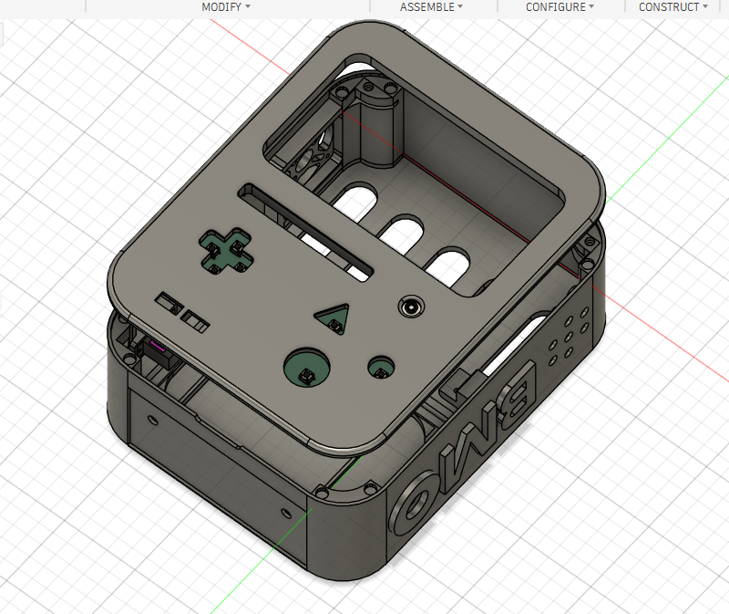

# BMO AI Robot

🌐 **언어:** [English](README.md) | **한국어**

**[BMO 작동 구조와 개발 계획](docs/BMO_OPERATION_PLAN_KR.md)** — 실행·대화·버튼·표정·팔·노래·게임의 상세 계획은 별도 페이지에 정리합니다.

**2026-10-22 개발 현황:** 얼굴 **v13.2**는 사용자 시각·동작 승인을 마쳤고, **Fish Aaron Soft 음성 대화**는 Pi 실사용 이력이 있습니다. 다음 단계는 얼굴과 음성의 실제 연결입니다. [통합 기준·현재 상태·개발 순서](docs/development/BMO_INTEGRATION_2026-10-22_KR.md)에서 확인할 수 있습니다.

<!-- 대표 사진이 준비되면 아래 블록의 주석을 해제하고 사진 URL을 넣습니다.

  
   
  7인치 화면을 기준으로 직접 설계한 BMO

-->

> **큰 BMO를 갖고 싶어서 시작했습니다.** 7인치 화면을 먼저 고르고, 그 화면에 맞는 외형과 내부 구조를 직접 설계했습니다.

| 항목 | 구성 |
|---|---|
| 메인 컴퓨터 | Raspberry Pi 5 8GB |
| 화면 | 7인치 DSI 터치 디스플레이 — 작동 확인 |
| 기구 설계 | Fusion 360 솔리드 모델, 원작 대비 약 135% |
| 하드웨어 제어 | RP2040-Zero 기반 맞춤형 PCB |
| 저장 장치 | NVMe SSD 1TB, microSD 512GB |
| 현재 단계 | 최종 얼굴·주 음성 선택 완료, 얼굴·음성 1차 통합 준비 |

---

## 목차

- [프로젝트 소개](#프로젝트-소개)
- [제작 자료](#제작-자료)
  - [3D 모델링과 프린팅](#3d-모델링과-프린팅)
  - [하드웨어 구성](#하드웨어-구성)
  - [맞춤형 PCB](#맞춤형-pcb)
  - [소프트웨어](#소프트웨어)
  - [BOM 및 비용](#bom-및-비용)
- [조립 및 검증](#조립-및-검증)
- [Troubleshooting & Design Changes](#troubleshooting--design-changes)
- [진행 현황](#진행-현황)
- [원작과 협찬](#원작과-협찬)
- [라이선스](#라이선스)

---

## 프로젝트 소개

작은 BMO 소품보다 **실제로 곁에 두고 사용할 수 있는 큰 BMO**를 만들고 싶었습니다. 그래서 7인치 터치 디스플레이를 기준으로 본체를 원작 모델 대비 약 **135%** 크기로 키웠습니다.

이 프로젝트는 [brenpoly의 Be More Agent](https://github.com/brenpoly/be-more-agent)에서 영감을 받았습니다. 원작자가 공개한 [BMO 외형 OBJ 파일](https://github.com/brenpoly/be-more-agent/releases/tag/v1.0-enclosure)을 보면서 Fusion 360에서 솔리드 모델을 직접 다시 그렸습니다. 원본 메시 파일을 단순 확대해 출력한 모델은 아닙니다.

BMO에 화면, 물리 버튼, 팔, 카메라와 오디오를 통합하고 음성 대화를 구현하는 것이 목표입니다. 향후 장착된 SSD를 활용해 개인 홈페이지와 프로젝트 자료를 제공하는 서버로 확장할 계획입니다.

## 제작 자료

### 3D 모델링과 프린팅

**Fusion 360에서 본체와 주요 조립부를 솔리드로 설계하고 출력했습니다.** 7인치 화면 장착부와 Raspberry Pi, 전원부, PCB, 스피커 및 배선 공간을 본체 내부에 반영했습니다.

- 원작 외형을 기준으로 약 135% 확대
- 7인치 화면에 맞춘 전면부 설계 및 실제 장착
- 내부 전자부품 배치와 조립 공간 설계
- 주요 기구 부품 모델링 및 출력 완료
- 팔다리는 최종 조립 중 일부 치수 수정 가능

  
   
  Fusion 360 본체 설계 화면 · 출력물 사진은 최종 조립 후 추가

### 하드웨어 구성

Raspberry Pi 5가 화면·카메라·오디오와 상위 소프트웨어를 담당합니다. 별도의 RP2040-Zero 기반 PCB가 버튼·IMU·팔 서보의 입출력을 담당하도록 설계했습니다.

| 영역 | 부품 | 확인된 상태 |
|---|---|---|
| 메인 컴퓨터 | Raspberry Pi 5 8GB | 사용 |
| 화면 | 7인치 DSI 터치 디스플레이 | 작동 확인 |
| 저장 장치 | NVMe SSD 1TB, microSD 512GB | 사용자 구성 확인, 전체 운용 검수 전 |
| 배터리 전원 | Geekworm X1203 UPS, X12-A1 배터리 보드, 18650 배터리 | 전체 통합 테스트 전 |
| 음성 입력 | USB 마이크 | 클라우드 STT를 포함한 Pi 대화 시험 이력, 최종 얼굴 연결 검수 전 |
| 음성 출력 | MAX98357A I2S 앰프, 스피커 | Fish Aaron Soft Pi 출력 이력, 최종 얼굴 동기화 검수 전 |
| 영상 입력 | Raspberry Pi Camera Module 3 Wide | 전체 통합 테스트 전 |
| 팔 구동 | 양팔 서보 | 개별 동작 시험 이력, 새 제스처 연동·검수 전 |
| 냉각 | Raspberry Pi Active Cooler, 본체 냉각팬 | 기존 독립 팬 제어 유지 |

서보 전원은 RP2040-Zero의 전원과 분리해 외부에서 공급하도록 설계했습니다. 전원부와 주변 장치의 전체 통합 결과는 조립 후 갱신합니다.

<!-- 내부 하드웨어 사진 또는 실제 배선도를 이 위치에 추가 -->

### 맞춤형 PCB

전면의 **방향 버튼 4개와 기능 버튼 3개**, MPU6050 IMU, 양팔 서보를 연결하기 위해 KiCad로 RP2040-Zero 기반 PCB를 설계했습니다. Raspberry Pi와 RP2040-Zero는 USB로 연결합니다.

| 기능 | PCB 구성 |
|---|---|
| 입력 | 푸시 버튼 7개 |
| 자세 센서 | MPU6050 |
| 출력 | 오른팔·왼팔 서보 커넥터 |
| 제어 | RP2040-Zero 모듈 |
| 서보 전원 | RP2040 전원과 분리한 외부 공급 |

PCBWay에 **PCB 제조와 SMT 부품 실장**을 의뢰했습니다. MPU6050, 저항과 커패시터 등 SMD 부품은 업체 실장 대상입니다. RP2040-Zero 모듈, 푸시 버튼, 서보 커넥터 등 관통홀 부품은 PCB 수령 후 직접 납땜합니다.

PCB를 수령한 뒤 **RP2040 버튼·양팔의 개별 동작 시험**까지 진행한 이력이 있습니다. 새로운 질문 버튼 배치와 팔 연출의 전체 연동은 아직 검수 전이며, MPU6050은 이상 진단 기록 때문에 사용을 보류합니다.

➡️ **[PCB 설계·핀 배치·실장 구분·제조 파일·검증 계획 자세히 보기](docs/PCB_DESIGN_KR.md)** — 각 부분에 추가하면 좋은 사진과 영상도 표시했습니다.

<!-- PCB 앞·뒷면 렌더링과 실장 완료 사진을 이 위치에 추가 -->

### 소프트웨어

| 부분 | 역할 | 상태 |
|---|---|---|
| RP2040 펌웨어 | 버튼 입력, 양팔 서보 제어; IMU는 보류 | 기존 HID·팔 펌웨어 사용, 새 대화·제스처 연동 전 |
| 얼굴 | 승인된 HTML/SVG 표정·듣기·생각·말하기 | **BMO_Screen_v13_2.html 최종 시각·동작 승인**, Pi 대화 연결 전 |
| Raspberry Pi 프로그램 | 대화 흐름·화면·오디오·기능 관리 | 기존 대화 worker 재사용, 얼굴·입·실제 재생 중 취소 연결 준비 |
| 음성 대화 | 클라우드 STT → GPT → Fish Audio | **Aaron Soft 실기 대화 이력**. Luna low 선택은 통합 프로필에 반영할 단계 |
| 로컬 백업 | Piper 영어 음성 합성 | 원본 무보정 선택, opt-in 장애 자동 전환의 Pi 검수는 남음 |
| 명령 처리 | 팔·사진·노래·게임 요청 검증 | Action v0 코드·CI 존재, **Mock만 구현**, 실제 장치·대화 연결 전 |
| 게임 | USB 레트로 게임패드와 게임 메뉴 | v3 준비팩·연동 시험용 Tetris 존재, 다른 원본 수집·Pi 검수·얼굴 복귀 미완료 |
| 개인 서버 | 홈페이지·포트폴리오·프로젝트 자료 제공 | 후속 개발 |

로컬 AI는 Raspberry Pi에서 실제 구동 시험을 마친 뒤 클라우드 GPT 기반으로 전환했습니다. 현재 [음성 개발 계열](https://github.com/GUNOBAE/BGH_BMO/tree/feature/bmo-luna-low-voice-ab)에 기존 대화·Fish·Piper·Luna 선택 코드가 있습니다. 사용자 선택은 **Luna low + Fish Aaron Soft + Beemo 발음 + PCM gain 0.25**이며 기존 GPT-4.1 mini 실행을 비교·복구용으로 보존합니다. 이 선택이 코드 기본값이나 현재 Pi 배포 설정에 이미 반영됐다는 뜻은 아닙니다.

말투·언어·감정·행동 결과의 발화 규칙은 [대화·음성 운용 규칙 v1](https://github.com/GUNOBAE/BGH_BMO/blob/707c66b8876130be75ad216fa10aaabf2bdcdb56/docs/voice-policy-v1/README_KR.md)에 정리했습니다. 최종 얼굴·음성·버튼·팔을 함께 연결한 BMO의 실물 검수는 남아 있습니다.

[야간 개발 보고서](https://github.com/GUNOBAE/BGH_BMO/blob/a2f895ea9f078c655f0db1a17d704008bbde7bb5/docs/reports/NIGHTLY_STATUS.md)의 테스트 통과는 해당 작업의 검사 기록이며 **사용자의 최종 승인과 다릅니다.** 상세 작동 방식과 검토 중인 동작은 [별도 계획 페이지](docs/BMO_OPERATION_PLAN_KR.md)에서 정리합니다.

<!-- 실행 방법과 데모 영상은 해당 소프트웨어가 동작한 뒤 추가 -->

### BOM 및 비용

아래 표는 **BMO 한 대에 실제 사용할 부품**의 수량과 비용을 기록하기 위한 것입니다. 여분·비교용·시험용·미사용 구매품은 최종 사용 비용에서 구분합니다.

| 분류 | 부품 | 사용 수량 | 실제 사용 비용 |
|---|---|---:|---:|
| 컴퓨팅 | Raspberry Pi 5 8GB | 1 | 정산 예정 |
| 화면 | 7인치 DSI 터치 디스플레이 | 1 | 정산 예정 |
| 저장 | SSD | 1 | 정산 예정 |
| 전원 | Geekworm X1203 UPS | 1 | 정산 예정 |
| 전원 | Geekworm X12-A1 배터리 보드 | 1 | 정산 예정 |
| 전원 | 18650 배터리 | 4 예정 | 정산 예정 |
| 오디오 | USB 마이크 | 1 | 정산 예정 |
| 오디오 | MAX98357A 앰프, 스피커 | 각 1 예정 | 정산 예정 |
| 영상 | Camera Module 3 Wide 및 연결 케이블 | 각 1 예정 | 정산 예정 |
| 구동 | 양팔 서보 | 2 예정 | 정산 예정 |
| 냉각 | Pi Active Cooler, 본체 냉각팬 | 각 1 예정 | 정산 예정 |
| PCB | 맞춤형 PCB 및 SMT 실장 | 최종 사용량 기준 | PCBWay 협찬 |
| 기구 | 출력 소재, 볼트·너트 등 | 실제 사용량 기준 | 정산 예정 |
| **합계** | **BMO 한 대의 실제 사용 비용** | | **정산 예정** |

**확인된 구매액:** AliExpress 주문 13건의 결제 합계는 **174,120원**입니다. 여분과 시험용 구매품이 포함되고 다른 구매처의 부품은 빠져 있어, 이는 **최종 제작비가 아닙니다.**

PCB 제조·SMT 실장·배송비는 PCBWay 협찬을 받았습니다. 사용 부품이 확정되면 전체 구매액, 실제 사용 비용, 협찬 금액과 직접 지출액을 구분해 정리하겠습니다.

## 조립 및 검증

지금까지의 개별 시험 이력과 남은 전체 통합 검증을 구분합니다. 개별 동작이나 자동 테스트 통과는 사용자의 최종 승인과 다릅니다.

| 항목 | 결과 |
|---|---|
| 7인치 화면 | 실제 장착 및 화면 작동 확인 |
| 3D 프린팅 | 주요 부품 출력 완료, 팔다리 일부 수정 가능 |
| 로컬 AI | 실제 구동 시험 완료, 대화 성능은 목표에 미치지 못함 |
| 맞춤형 PCB | 수령 후 RP2040 버튼·양팔 개별 동작 시험 이력, IMU 사용 보류 |
| 얼굴 v13.2 | 사용자 시각·동작 승인 완료, Pi 음성 연동은 미검수 |
| Fish 음성 대화 | Pi 마이크·STT·GPT·Fish·스피커 사용 이력, 최종 얼굴·취소 동작 통합은 미완료 |
| 전체 BMO | 전원·오디오·카메라·팔 최종 통합 검수 및 사용자 승인 전 |

기존 버튼·팔 시험 결과를 보존하면서 새 대화·얼굴·입력·팔 연출을 순서대로 연결합니다. IMU는 별도로 대기하며, 과거 시험을 다시 수행했다거나 전체 기능이 승인됐다고 표시하지 않습니다.

## Troubleshooting & Design Changes

직접 시험하거나 제작하며 확인한 문제와 그에 따른 변경만 이곳에 기록합니다.

### 메시 모델을 솔리드로 재설계

원작 OBJ의 외형을 참고해 화면 장착부와 내부 조립 구조를 수정하려 했습니다. 메시 형상으로 치수와 결합부를 관리하기 어려워 **Fusion 360에서 솔리드 모델을 직접 다시 설계**했습니다.

### 로컬 AI 시험 후 방향 변경

Raspberry Pi AI 가속기로 로컬 AI를 시험했지만, 대화 성능이 목표에 맞지 않았습니다. 가속기를 제거하고 SSD를 장착했으며, 대화 기능은 **GPT API 기반으로 전환**했습니다. 관련 코드는 개발 브랜치에 있으며, 새 얼굴·음성·하드웨어 조합의 최종 통합 검수는 남아 있습니다.

<!-- 새 문제를 실제로 확인하고 해결하면 증상 → 원인 → 수정 → 재시험 결과 순서로 추가 -->

## 진행 현황

- [x] 7인치 화면 기준 약 135% 크기의 본체 설계
- [x] Fusion 360 모델링과 주요 기구 부품 출력
- [x] 7인치 디스플레이 작동 확인
- [x] 로컬 AI 시험, AI 가속기 제거 및 SSD 장착
- [x] 맞춤형 PCB 설계 및 제조·SMT 실장 발주
- [x] PCB 수령 및 버튼·팔 개별 동작 시험 이력
- [x] 얼굴 v13.2 시각·동작 승인 및 기준본 확정
- [x] Fish Aaron Soft 주 음성 선택과 Pi 대화 시험 이력
- [x] 원본 무보정 Piper 백업 선택, 로컬 음색 추가 보정 종료
- [x] Action v0 Mock 코드·자동 검사 및 게임 v3 준비팩 작성
- [ ] 얼굴·음성·입 동작·실제 재생 중 취소 1차 통합
- [ ] PCB 전체 기능 검수 — 버튼·팔의 새 연동은 검수 전, IMU는 보류
- [ ] 팔다리 수정과 전체 하드웨어 조립
- [ ] RP2040 펌웨어 및 Raspberry Pi의 새 대화·제스처 연동
- [ ] GPT 기반 음성 대화와 카메라 상호작용의 최종 통합
- [ ] 게임 파일 수집·USB 패드 실기 검수·게임 종료 후 얼굴 복귀
- [ ] 로컬 노래 등록, 호출어/VAD, 수동 앱 실행·종료 검수
- [ ] 개인 서버 구축

## 원작과 협찬

- **원작 프로젝트:** [brenpoly — Be More Agent](https://github.com/brenpoly/be-more-agent)
- **외형 참고 파일:** [BMO Enclosure OBJ Release](https://github.com/brenpoly/be-more-agent/releases/tag/v1.0-enclosure)
- **PCB 제조 협찬:** [PCBWay](https://www.pcbway.com/) — PCB 제조, SMT 실장 및 배송 지원

이 프로젝트는 개인 팬 프로젝트입니다. 현재 완성품이나 설계 파일을 판매할 계획이 없으며, brenpoly 또는 *Adventure Time*의 권리자가 공식 승인한 제품은 아닙니다.

## 라이선스

원작 외형을 참고해 다시 설계한 3D 모델은 **CC BY-NC-SA 4.0** 조건에 맞춰 공개할 예정입니다. 재사용할 때는 원작자 **brenpoly**와 이 프로젝트의 모델링 기여자 **GUNOBAE**를 함께 표시하고, 변경 사항과 라이선스를 명시해 주세요. 해당 라이선스는 상업적 이용을 허용하지 않습니다.

직접 작성한 코드와 독립적으로 설계한 PCB 파일의 라이선스는 공개 전에 적용 범위를 구분해 명시하겠습니다. 이 저장소는 BMO 캐릭터 자체에 대한 권리를 부여하지 않습니다.
