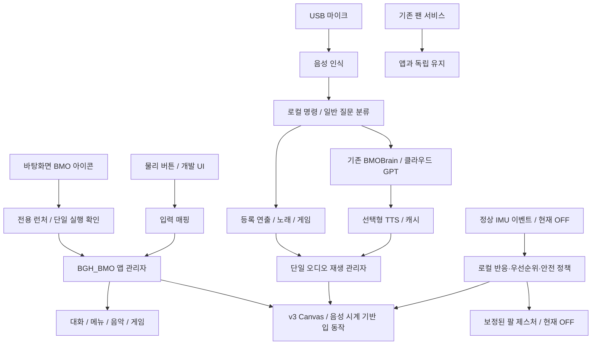
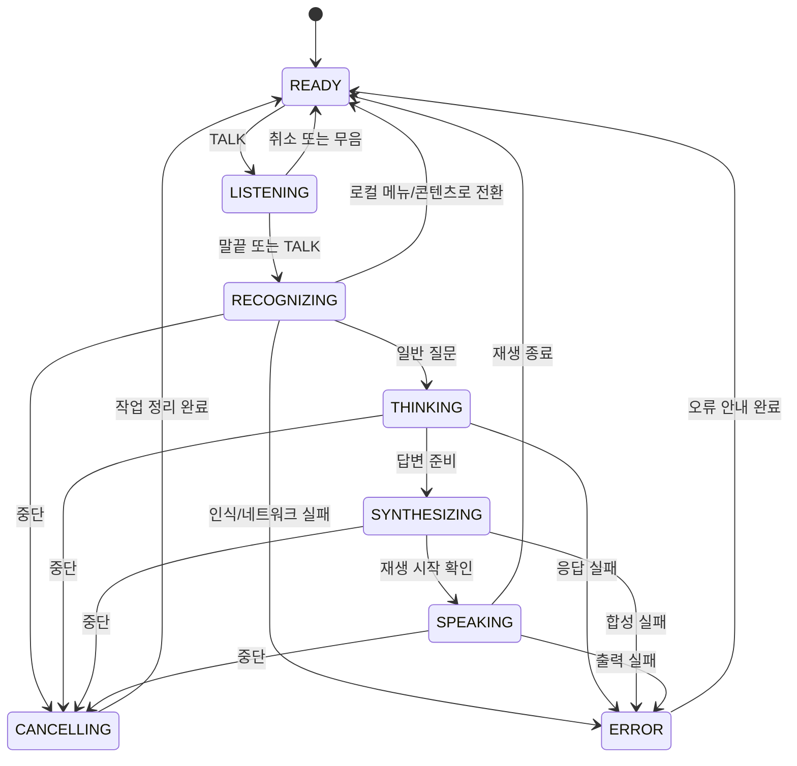

# BMO 동작·버튼·아키텍처 명세

**버전 0.1 · 2026-10-17 · 설계 초안 / 실행 승인 아님**

[제품 계획서](BMO_PRODUCT_PLAN_KR.md)를 기능 범위의 기준으로 삼는다. 이 문서는 실제 구현 코드와 구분되는 목표 동작이다. 버튼·센서·오디오 변경은 기존 장치 상태를 감독하에 대조한 뒤 적용한다. 수치는 초기 튜닝값이며 실측·안전 보증값이 아니다.

## 1. 두 시스템을 분리한다

### 개발 시스템

사용자 요구 → 한국어 제품 결정 → GitHub 문서/작업 범위 → Pi Codex 구현·검사 → 코드/보고서 동기화 → 사용자 실물 평가.

Codex는 개발 도구다. 평소 BMO와 대화하기 위해 Codex나 이 ChatGPT 창을 실행해 둘 필요가 없는 제품을 만든다. GitHub의 파일과 Pi의 파일은 동기화하기 전까지 같다고 가정하지 않는다.

### 제품 실행 시스템

화살표는 책임 관계다. 이미 구현된 연결이나 실제 하드웨어 승인을 뜻하지 않는다. 같은 머신의 다른 웹서버와는 프로세스·포트·자산 루트를 분리한다. 마이크·스피커·게임·팔 제어는 LLM이 직접 호출하는 임의 셸 명령이 아니다.

## 2. 실제 코드와 새 연결부

| 계층 | 재사용 | 필요한 연결/추가 |
|---|---|---|
| 대화 | `core.py`, `cloud.py`, `config.py` | 한 세션의 문맥 관리자, 영어 우선 정책 선택 |
| 작업/취소 | `conversation.py`, `app.py` | 앱 모드와 turn ID 연결, 로컬 액션 라우터 |
| 음성 | `audio.py`, Lab 제공자 후보 | 합성/재생 책임 분리, 실제 녹음 취소, 단일 출력 소유자 |
| 얼굴 | v3 HTML/geometry/app 코드 | 대화 단계·감정·오디오 이벤트와 웹 UI 연결 |
| 장치 | 기존 하드웨어 계약·현재 RP2040 펌웨어 | 검증된 입력 매핑, 감독 후 전용 제스처/센서 어댑터 |
| 운영 | 기존 팬·SSH 등 | BMO 전용 런처, 단일 실행, 정리·복구·홈/설정 |
| 미디어 | 기존 캐시/오디오 UI, 검토한 외부 게임 | 등록 카탈로그, 플레이어/게임 수명주기 어댑터 |

최종 통합 런처·API 명령 이름은 아직 존재하지 않는다. 문서의 설계용 모듈/이벤트 이름을 바로 실행 가능한 명령으로 안내하지 않는다. Lab 서버를 두 번째 영구 대화 엔진으로 만들지 않는다.

## 3. 상태를 네 축으로 관리한다

| 축 | 값 | 의미 |
|---|---|---|
| 앱 수명 | OFF / STARTING / RUNNING / STOPPING / FAILED | Pi 전원 상태와 별개 |
| 활동 | IDLE / CONVERSATION / MENU / MUSIC / GAME | 화면·입력·오디오 소유자 |
| 대화 단계 | READY / LISTENING / RECOGNIZING / THINKING / SYNTHESIZING / SPEAKING / CANCELLING / ERROR | 한 턴의 진행 |
| 연출 | neutral / happy / surprised / sad / annoyed / unsure + 강도 | 감정. 게임 화면을 자동으로 덮지 않음 |

별도 안전 조건: `imu_health`, `motion_context`, `arms_enabled`, `recording_enabled`, `network_available`. 예컨대 즐거운 감정이라도 이동 중이면 팔을 움직이지 않는다. 네트워크가 끊겼어도 로컬 음악은 사용할 수 있다.

## 4. 실행·종료·복구 계약

### 시작

1. 사용자가 바탕화면 아이콘을 누른다. 기존 `.desktop` 규격 기반 런처를 사용하되 실제 경로는 구현 때 검증한다.
2. 앱 소유 잠금/프로세스 확인 후 이미 실행 중이면 기존 창을 표시한다. 두 번째 서버·마이크·재생기를 만들지 않는다.
3. 루프백 서버와 전용 화면을 시작하고 readiness를 확인한다. 기존 포트가 점유됐으면 설명하고 중단하며 점유 프로세스를 죽이지 않는다.
4. 원본 자산/환경 문제는 구체적으로 표시한다. 무자산 대체 화면을 보여주면서 원본 얼굴 통합 완료라고 보고하지 않는다.
5. 준비 완료 상태에서만 질문 입력을 받는다. 시작 즉시 녹음·모터 이동·클라우드 호출을 하지 않는다.

### 종료

초록 길게 → 홈 → 시스템 → BMO 종료 → 확인. 처리 순서는 신규 입력 금지 → 녹음/자체 음성 정지 → 게임 종료 → 턴 무효화/취소 → 자체 자원 정리 → 바탕화면 복귀다. 앱 종료가 곧 `shutdown`, `reboot`, 팬 중지 또는 다른 서버 정지를 뜻하지 않는다.

모터가 비활성/고장/이동 중이면 종료 시 일괄적으로 중립 각도로 보내지 않는다. 정상 활성 상태에서도 안전한 복귀가 검증된 경우에만 제한된 정리 정책을 수행한다. "닫기" 때문에 팔이 갑자기 움직이지 않아야 한다.

### 비정상 상황

UI 연결이 끊기면 로봇 출력을 계속 진행하지 않는 방향을 목표로 한다. 현재 작업을 취소 요청하고 새 입력을 막으며, 브라우저 재접속만으로 옛 음성을 재생하지 않는다. 원격 요청이 취소됐는지 알 수 없으면 완료로 기록하지 않는다. 시작 실패를 무한 재시작으로 숨기지 않는다. 사용자가 앱을 종료한 이후에는 자동으로 다시 켜지지 않는다.

## 5. 버튼 계약

### 하드웨어 원본과 목표 배치는 다르다

과거 확인된 펌웨어는 방향 GP2/3/4/5, 세모 GP6, 빨강 GP7, 초록 GP8과 팔 GP10/11을 사용한다. 과거 매핑에는 세모=Z, 초록=Enter, 빨강=팔 토글이라는 기록이 있다. 사용자가 이번에 원하는 세모=확인은 **목표 의미**이며 현재 HID 코드와 같다고 가정하지 않는다.

앱에서 `CONFIRM`, `BACK`, `TALK`, `UP/DOWN/LEFT/RIGHT`로 변환한다. 세모의 Z를 확인으로 해석하는 것은 앱 매핑으로 해결할 수 있지만, GP7의 독립 팔 동작은 앱 매핑만으로 제거되지 않는다. 펌웨어 백업/실물 검토와 명시 승인이 필요하다. 그전에는 일반 키보드·개발 UI로 검증하며 로봇 빨간 버튼 테스트를 지시하지 않는다.

### 추천 매핑

| 물리 버튼 | 얼굴 대기/대화 | 메뉴 | 노래 | 게임 |
|---|---|---|---|---|
| 십자 | 대기에서 메뉴 탐색 진입; 대화 중 불필요한 동작 없음 | 상하/좌우 이동 | 목록 탐색; 재생 중 상하 앱 음량, 좌우 기본 비활성 | 이동 |
| 파란 세모, 짧게 | 대기에서 홈 메뉴 열기 | 선택/확인 | 선택/재생·일시정지 | A: 점프/기본 동작 |
| 초록 원, 짧게 | 진행 턴 취소; 대기에서는 효과 없음 | 한 단계 뒤로 | 재생 정지 후 곡 목록 | B: 보조 동작 |
| 초록 원, 길게 | 현재 활동 정리 후 홈 메뉴 | 홈 메뉴 | 정지 후 홈 메뉴 | 종료 요청 후 홈 메뉴 |
| 빨간 원, 짧게 | 준비: 녹음 시작 / 녹음 중: 마치고 제출 / 생각·말하기 중: 중단 요청 | 질문 준비 또는 녹음 시작(종료 확인창에서는 무시) | 먼저 일시정지하고 질문 준비, 다음 누름에서 녹음 | 먼저 일시정지 메뉴. 게임 실행 중 직접 녹음하지 않음 |

게임 일시정지 메뉴에서 빨강을 다시 누르면 대화로 전환할 수 있지만 게임 진행 상태는 보존하거나 저장 불가를 표시한다. BMO 종료와 게임 종료는 다르다. 모든 게임은 앱의 전역 탈출 입력을 독점/차단하면 도입하지 않는다.

길게 누르기 초기값은 1.5초다. 짧게/길게 동작이 둘 다 발생하지 않도록 소비 규칙을 둔다. 게임에서 초록을 누른 순간 B가 먼저 작동할 수 있으므로 긴 누름을 시작할 때의 부작용을 검수하고, 필요하면 게임별 매핑에서 즉시 B와 전역 길게 탈출을 분리한다. 전역 탈출 이벤트는 게임 프레임 처리와 독립되어야 한다.

버튼 디바운스 초기값 40ms, 메뉴 자동 반복 시작 400ms/간격 120ms를 제안한다. TALK/CONFIRM은 눌린 동안 자동 반복하지 않는다. 릴리스 누락·USB 재연결 때도 녹음을 무기한 유지하지 않는다.

## 6. 한 턴의 대화 흐름

### 입력 정책 초기값

버튼 누름 뒤 최대 3초 안에 말소리가 시작되지 않으면 업로드 없이 대기로 복귀한다. 말소리가 시작된 뒤 0.9초 연속 무음이면 제출하고, 전체 녹음은 최대 10초로 제한한다. 빨강으로 조기 제출, 초록으로 버림/취소가 가능하다. 최소 발화 길이·무음 임계값은 실제 USB 마이크와 전시 소음에서 조정한다. 이 값들은 확정된 정확도 수치가 아니다.

음성 입력 창 밖에서는 클라우드로 녹음을 보내지 않는다. VAD는 해당 입력 창에서만 활성화한다. 말하기·음악·게임 중 마이크 캡처는 기본 OFF다. 다음 녹음은 출력 정지/장치 준비를 확인한 뒤 시작한다. 입력 준비 표시가 실제 준비보다 먼저 켜지지 않게 한다.

### 취소와 늦게 도착한 결과

모든 작업에 `session_id`, `turn_id`와 취소 세대를 붙인다. 취소/새 모드/종료 이후의 응답은 재생·화면·메모리 갱신에 사용하지 않는다. 이미 blocking IO 중인 작업은 즉시 멈추지 않을 수 있으므로 `cancel_requested`와 `worker_finished`를 구분한다. 기존 단일 worker가 종료되지 않았다면 새 유료 턴을 병렬로 쌓지 않는다.

오래된 요청을 기다리느라 UI가 정지하지 않아야 한다. 사용자는 로컬 홈으로 빠져나갈 수 있고, 새 질문은 준비 상태를 확인한 뒤 허용한다. 네트워크 요청이 이미 처리·청구됐을 가능성을 "취소 성공=비용 0"이라고 표시하지 않는다.

## 7. 입력 의도와 액션 라우터

우선순위: **중단/종료 → 명시 버튼/메뉴 → 등록 로컬 명령 → 일반 GPT 대화**.

간단한 곡/게임 선택은 STT 텍스트를 정규화해 로컬 카탈로그에서 먼저 찾는다. 애매하면 선택 화면이나 한 번의 확인 질문을 내보낸다. 등록되지 않은 곡/게임은 있다고 말하지 않는다.

처음부터 GPT가 임의 파일명·URL·셸·각도·펌웨어 명령을 만들게 하지 않는다. 필요 시 GPT가 제안할 수 있는 것은 허용된 감정/동작/카탈로그 ID뿐이고 스키마·현재 모드·쿨다운·안전 조건을 검증한 뒤 실행한다. 장치 명령은 로컬 정책의 출력이다.

| 예시 입력 | 로컬 판정 | 결과 |
|---|---|---|
| 게임 하고 싶어 / Let's play a game | OPEN_GAME_MENU | 등록 게임만 표시, 선택 안내 |
| 노래해 줘 / Sing a song | OPEN_MUSIC_MENU | 보유 곡 목록 표시 |
| 등록된 곡 제목 | PLAY_TRACK(id) | 정확한/확인된 ID만 재생 |
| 다시 말해 줘 | REPLAY_LAST | 현재 세션의 캐시 오디오, 없으면 없음 안내 |
| 네가 뭘 할 수 있어? | CAPABILITIES | 실제 활성 기능으로 작성된 로컬 안내 |
| 새로운 일반 질문 | ASK_GPT(text) | 문맥 제한 내 클라우드 응답 |
| 앱 종료 요청(음성) | OPEN_EXIT_CONFIRM | 바로 종료하지 않고 확인 화면 |

고정 소개/메뉴 안내에도 존재하지 않는 능력을 넣지 않는다. 사용자가 요청한 노래/게임을 찾기 위해 런타임에서 인터넷을 검색하고 자동 설치하지 않는다.

## 8. 연출 카탈로그

기본 반응은 동영상 파일을 계속 재생하는 방식만을 뜻하지 않는다. 원본의 눈·입·윤곽을 유지하는 **로컬 애니메이션 설정/타임라인 + 선택적 짧은 음성 + 선택적 보정 제스처** 묶음이다. 원본 PNG를 늘리는 작업으로 대체하지 않는다.

| 슬롯 | 트리거 | 얼굴 | 음성 | 팔/제약 |
|---|---|---|---|---|
| idle | 대기 | 자연 깜빡임/작은 시선 이동 | 없음 | 기본 정지 |
| listening | 실제 녹음 시작 | 집중 | 없음 | 정지 |
| thinking | STT/GPT/TTS 대기 | 생각하는 루프 | 기본 없음 | 정지 |
| greet | 준비 완료 또는 명시 인사 | 밝음 | 승인된 인사 1개 | 감독 활성 시 wave 후보 |
| ack | 메뉴 선택 확정 | 작은 긍정 | 기본 무음/선택적 짧은 클립 | 없음 |
| choose_game | 게임 메뉴 | 기대 | 선택 안내 클립 | 없음 |
| choose_song | 음악 메뉴 | 기대 | 선택 안내 클립 | 없음 |
| happy | 제한된 성공/긍정 이벤트 | 행복 | 대화 오디오 또는 승인 클립 | cheer 후보 |
| unsure | 모름/선택 불명확 | 곤란함 | 솔직한 짧은 안내 | shrug 후보 |
| lifted | 정상 센서 들림 유사 | 짧은 놀람 | 기본 무음 | 이동 중 팔 금지 |
| offline | 클라우드 사용 불가 | 곤란함 + 연결 안내 | 최초 1회 로컬 안내 | 없음 |
| goodbye | BMO 종료 확인 후 | 인사 | 선택적 짧은 클립 | 복귀 안전성이 검증된 때만 |

12개는 상한 슬롯이고, 모든 슬롯에 새 오디오를 만들어야 하는 것은 아니다. 시작/종료 클립은 그 때문에 앱 종료가 막히지 않게 제한한다. 원작 긴 대사 수집이 아니라 허용된 사전 제작 자산을 사용한다.

클립에는 `action_id`, 얼굴 타임라인, 오디오 ID, 입 cue ID, 허용 모드, 우선순위, 중단 가능 여부, 지속시간, 쿨다운을 기록한다. 고정 클립 큐가 쌓여 과거 상황을 나중에 연기하지 않도록 낮은 우선순위는 최신 1개만 유지하거나 버린다.

## 9. 충돌·우선순위

| 상황 | 처리 |
|---|---|
| 말하는 중 중단 버튼 | 로컬 재생 정지 우선, 턴 취소·옛 응답 폐기, 새 녹음은 다음 입력 |
| 듣는 중 놀람 센서 이벤트 | 녹음 방해 음성·팔 없음. 얼굴 반응도 이해를 방해하지 않는 범위만 |
| 게임 중 들림 유사 이벤트 | 게임 계속, 자동 팔 OFF, 얼굴로 게임을 덮지 않음 |
| 음악 중 새 질문 | 음악 먼저 정지/일시정지, 녹음 준비 확인 후 입력 |
| 네트워크 실패 | 한 번 안내, 로컬 기능 유지, 자동 재시도 무한 반복 금지 |
| 사용자 종료와 제스처 예약 겹침 | 예약 취소. 새 제스처 시작 금지 |
| 한 번에 여러 입력 | 현재 모드와 이벤트 세대로 판별, 질문 큐 무제한 적재 금지 |

오디오 우선순위는 중단/안전 → 사용자 선택 콘텐츠/대화 → 짧은 자율 반응이다. 대화·노래·게임 소리를 동시에 믹싱하는 기능은 v1.0에서 제외한다. 게임의 효과음도 동일한 출력 소유권 아래 둔다.

## 10. IMU 반응은 건강한 센서 이후

현재 MPU6050은 포화·바이어스·self-test 이상 기록이 있어 `imu_health=UNTRUSTED`다. 이 상태에서 값을 보정해 정상처럼 사용하거나 팔 제어로 연결하지 않는다. 진단 스크립트의 종료 과정이 펌웨어를 재실행할 수 있으므로 읽기와 실행을 구분한다.

검증 후 목표 이벤트는 다음 세 가지다.

| 이벤트 | 의미 | 반응 |
|---|---|---|
| lift_like | 안정 상태에서 움직임이 시작된 들림 유사 패턴 | 짧은 놀란 얼굴, 기본 무음, 팔 억제 |
| tilt | 정한 자세 기준에서 충분히 지속된 기울어짐 | 눈/표정 변화. 연속 회전 추종 아님 |
| settled | 움직임이 줄고 일정 시간 안정 | 중립 대기 복귀, 이후 이벤트 재허용 |

가속도/자이로만으로 "누가 들었다", "몇 미터 걸었다"를 확정하지 않는다. 센서는 실제 의미가 아닌 움직임 패턴을 제공한다. 낙하 감지나 충돌 회피용 안전 장치로 쓰지 않는다.

초기 설계는 필터+지속시간+상승/하강 임계 차이+10초 쿨다운+안정 2초 후 재무장이다. 실제 임계 g·각도는 정상 센서 캡처 후 결정하며 미리 고정하지 않는다. 이동 중에는 반복 놀람과 팔 연기를 억제하고, 게임/음악 중 센서 반응은 기본 무음이다. IMU 상실 시 제스처를 자동 허용하지 않고 비활성으로 내려간다.

## 11. 팔 동작은 승인된 작은 제스처만

| 제스처 | 의미 | 계획 |
|---|---|---|
| cheer | 신남 | 보정된 제한 범위에서 양팔 상승 후 복귀 |
| shrug | 모름/곤란 | 작은 비대칭 또는 제한된 양팔 동작 |
| wave | 인사 | 한 팔의 작은 왕복 |
| neutral | 대기 자세 | 검증된 기준 위치. 오류 때 무조건 이동 명령을 보내는 값은 아님 |

각도 숫자와 PWM 한계는 실물 보정 전 미정이다. 예전 0/180도 토글 값을 새 제스처 안전 범위라고 사용하지 않는다. 좌우 방향·최소/최대·속도·가속·기구 간섭을 확인한다. 공급 전원, 배선, 발열도 실물 검수 대상이다.

허용 조건: 정상 장치 + 운영자 활성화 + 보정 프로파일 + 이동 억제 해제 + 허용 활동 + 쿨다운. 기본은 OFF이며 게임·녹음·이동 중 OFF다. 한 번에 제스처 하나, 긴 동작 큐 없음, 초기 최대 1.5초/5초 쿨다운을 제안한다. 실제 안전 반응은 감독 시험으로 확정한다.

버튼으로 소프트웨어 동작을 멈추는 것은 하드웨어 비상정지와 동일하지 않다. 정지/통신 상실 때 유지·PWM 해제·중립 복귀 중 무엇이 안전한지는 기구·전원 조건에 따라 따로 확인한다. 앱 종료·RP2040 재연결·부팅 때 자동으로 팔을 끝까지 돌리지 않는다.

## 12. 노래·게임 어댑터 계약

### 미디어 등록

오디오 항목은 ID, 제목, 출처/사용 조건, 파일 해시, 길이, 허용 음량, 입 타임코드의 대응 해시를 가진다. 카탈로그 ID만 외부 입력으로 받고 임의 경로·URL을 실행하지 않는다. 파일 누락/손상/허용 길이 초과는 선택 전에 표시한다. 초기 2곡, 1회 재생 후 대기, 자동 다음 곡/무한 반복 OFF다.

원작 노래 재생은 로컬 파일 재생이지 모델이 노래를 생성하는 기능이 아니다. 입 움직임은 가능하면 미리 만든 cue, 없으면 v3의 에너지 기반 동작을 쓰되 반주도 입을 열 수 있는 한계를 표시한다. 노래에 맞춘 팔 춤은 첫 범위에서 제외한다.

### 게임 실행

`GameAdapter`는 계획상 `start`, `pause`, `resume`, `stop`, `is_running`, `supports_save`와 입력 매핑을 제공한다. shell 문자열이나 게임이 제공한 임의 명령을 그대로 실행하지 않는다. 기존 게임을 재사용하되 호스트가 종료 권한을 유지한다.

게임 화면이 전면에 있는 동안 LLM 대화·녹음·자율 제스처는 중지한다. 빨강은 앱의 일시정지, 세모는 A, 초록 짧게는 B, 초록 길게는 홈 탈출이다. 일시정지/상태 저장을 지원하지 않는 게임이면 "진행이 사라질 수 있음"을 확인하고 종료한다. 저장 지원을 임의로 약속하지 않는다.

외부 웹 게임을 같은 권한의 페이지로 무제한 내장하지 않는다. 검토한 로컬 빌드 또는 제한된 게임 실행 환경만 허용하고, 네트워크·카메라·마이크·파일시스템·앱 제어 토큰을 게임에 전달하지 않는다. 다른 Origin/격리 프레임이 필요하면 입력·음소거·탈출이 작동하는지도 검증한다. 일반 임베드만으로 격리가 끝났다고 판단하지 않는다.

## 13. 보안·개인정보·비용

BMO 제어 서버는 루프백에 바인딩하고 원래의 세션 토큰·Host/Origin 검사 방향을 유지한다. 향후 인터넷 공개 개인 웹서버와 BMO 제어 포트·자산·권한을 분리한다. 인터넷 공개 서버를 통해 녹음/서보/API 사용을 노출하지 않는다. API 키는 서버 로컬 환경/비밀 저장소에 두고 HTML·URL·Git·원시 로그에 넣지 않는다.

전시 기본안은 60초 동안 대화 입력이 없으면 문맥과 세션 음성 캐시를 비우는 것이다. 진행 중 응답/재생을 잘라내지는 않는다. 게임/노래 진입 시 대화 세션을 종료하는 것을 기본으로 한다. 설정 메뉴의 새 대화로 즉시 초기화할 수도 있다. 영구 개인 기억·녹음 보관·무인 카메라 촬영은 OFF다.

녹음 표시와 클라우드 전송 안내를 둔다. 로그는 상대 단계/시간/안전한 오류 코드만, 개인 발화·음원·프롬프트 원문은 기본 저장하지 않는다. 임시 파일과 캐시 정리는 정상 종료뿐 아니라 오류/취소에도 검사한다.

클라우드 사용은 사용자가 시작한 턴만이다. 메뉴/노래/게임 버튼 동작은 API 없이 처리한다. 음성 명령은 STT를 사용하므로 "로컬 명령이면 비용이 전혀 없다"고 표시하지 않는다. 앱의 API 비용과 Codex 개발 구독 사용량은 별도 관리하며, 기능 실행 승인이 추가 구매 승인인 것은 아니다.

앱 측 회수·출력 길이·재시도 제한과 사용량 추정 표시를 둔다. 정밀한 비용 상한은 제공자 과금·진행 중 요청과 차이가 있으므로 보장하지 않는다. 예상 일일 한도는 운영자가 정하고 소진하면 로컬 모드로 내린다. 실제 금액/계정 설정을 이번 문서가 자동 변경하지 않는다.

## 14. 구현·검수 시나리오

| ID | 입력/조건 | 기대 결과 | 관련 묶음 |
|---|---|---|---|
| T01 | 아이콘 두 번 클릭 | 앱 하나, 기존 창 표시 | P1 |
| T02 | 인터넷 없이 시작 | 얼굴/메뉴/등록 콘텐츠 사용, 대화 연결 불가 안내 | P1/P2 |
| T03 | 빨강 후 정상 발화 | 녹음 표시→말끝→답변→대기 | P2 |
| T04 | 빨강 후 무음 | 3초 후보 제한 후 업로드 없이 복귀 | P2 |
| T05 | 말하는 중 빨강 | 출력 정지·취소, 자동 녹음 안 함 | P2 |
| T06 | 취소 후 늦은 응답 | 화면·재생·문맥에 반영하지 않음 | P2 |
| T07 | 같은 질문 연속 입력 | 현재 worker 종료 전 큐 폭증/중복 과금 없음 | P2 |
| T08 | 다시 듣기 | 현재 세션 캐시 재생, 새 GPT/TTS 없음 | P3 |
| T09 | 곡 선택/중단/누락 | 등록 곡만 재생, 정지, 누락 안내 | P4 |
| T10 | 게임 중 빨강/초록 길게 | 일시정지/홈 탈출, 마이크 자동 시작 없음 | P5 |
| T11 | 게임이 종료 불응 | 전역 종료 경로 유지, 앱/서버 전체 강제 종료하지 않음 | P5 |
| T12 | 들고 계속 이동 | 반복 놀람 억제, 자동 팔 OFF | P6 |
| T13 | IMU 불신/통신 끊김 | 센서 연출과 팔 비활성, 기본 앱 유지 | P6 |
| T14 | 센서 이벤트와 녹음 겹침 | 반응 음성·팔이 녹음을 방해하지 않음 | P6 |
| T15 | BMO 종료 선택 | 바탕화면 복귀, 팬·SSH·개인 서버 유지 | P7 |
| T16 | UI/브라우저 충돌 | 옛 음성/동작 재개 안 함, 재시작 경로 표시 | P7 |
| T17 | 콘텐츠/대화 100회 전환 | 자체 자원 회수, 제한된 큐·캐시 유지 | P7 |
| T18 | 세션 만료 후 다음 관람객 | 전 사용자 문맥·재생 캐시 없음 | P7 |
| T19 | v3와 원본 비교 | 눈·입 비율/색·표정 보존, 각 상태 지속 확인 | P1/P3 |
| T20 | GP7/세모/초록 실제 매핑 | 질문으로 팔 움직이지 않음, 게임/메뉴 의미 일치 | P0/P2 |

모의 검사로 권한 경계를 먼저 시험한 뒤, 승인된 장치별 실물 검수로 넘어간다. 실패한 항목을 skip해서 제품 완료로 표시하지 않는다. 기존 검사에서 바뀌어야 하는 가정은 이유와 새 회귀 검사로 남긴다.

## 15. 인수인계 후 첫 작업의 산출물

P0는 분석과 기록만 수행한다. 필요한 결과는 다음 네 가지다.

1. 원본 파일 이름·버전·해시·출처·Pi 존재 여부와 현재 코드의 재사용 대조표.
2. 기존 Lab 서버/음성 캐시와 BGH_BMO의 차이, 단일 재생 경로 선택 검토.
3. 물리 버튼의 현재 코드와 목표 의미 대조, GP7 팔 토글 해소에 필요한 승인 범위.
4. P1의 정확한 변경 파일·검사·실물 확인·복구 계획. 원본 덮어쓰기나 배포는 아직 하지 않음.

`BMO_Lab_v3_Package.zip`의 `docs/CODEX_NEXT_KR.md`, 기존 `AGENTS.md`와 로컬 상태 문서를 함께 읽는다. 이번 초안은 그 문서들을 무조건 무효화하지 않는다. 충돌하면 기준 날짜와 최신 사용자 결정을 기록하고 임의로 넓은 권한을 택하지 않는다.

계획 승인 후에도 패키지 설치, 실제 마이크/스피커, 유료 API, 펌웨어/모터, 시스템 서비스, 제3자 콘텐츠 다운로드는 해당 작업 범위를 별도로 정한다. 이 문서를 읽었다는 사실만으로 모든 구현을 자동 승인받은 것이 아니다.

## 16. 근거와 한계

현재 코드의 근거는 기준 커밋 `a2f895ea9f078c655f0db1a17d704008bbde7bb5`와 [NIGHTLY_STATUS.md](reports/NIGHTLY_STATUS.md), 기존 CLI/하드웨어 문서다. 원본 v3는 사용자 Project/Library 소스에서 읽었다. 자세한 원본·외부 자료 목록은 [제품 계획서 12절](BMO_PRODUCT_PLAN_KR.md#12-근거와-재확인-대상)을 따른다.

기존 코드/기록에서 확인한 것과 이번 설계용 상태·인터페이스·튜닝값을 구분한다. 이번 문서 작성은 Pi에서 테스트를 실행하거나 게임·음원·모델을 설치한 일이 아니다. 사용자 선호 디자인을 복구한 것과 그 움직임/음색이 최종 승인된 것도 다르다.
