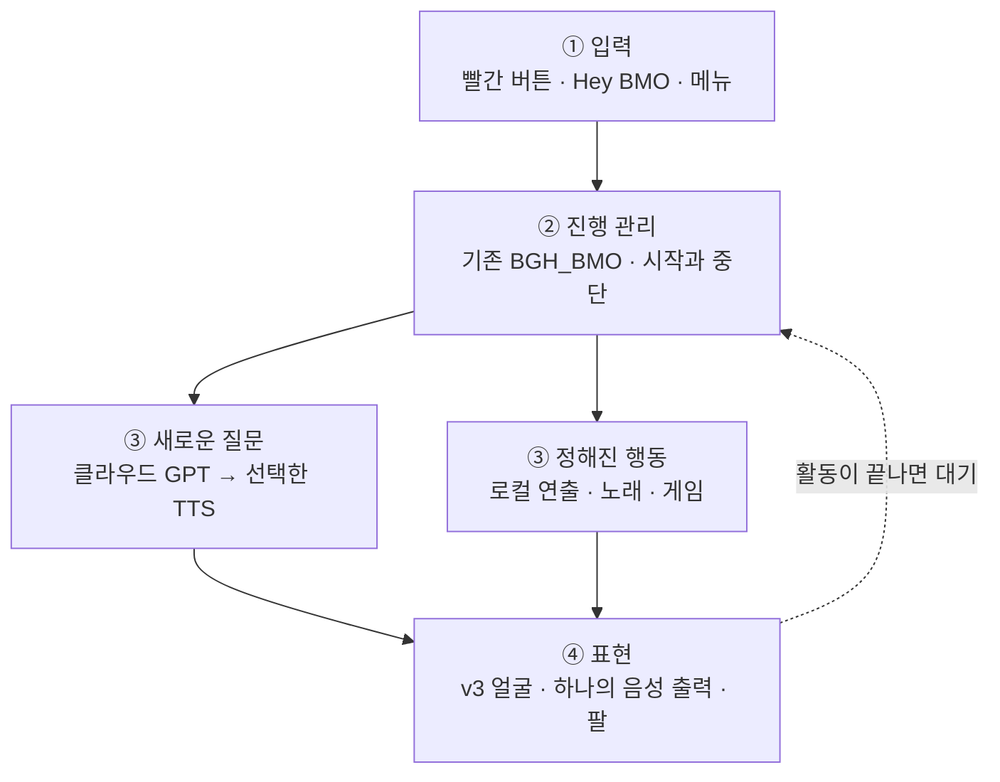
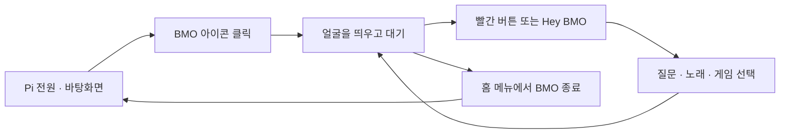

# BMO 작동 구조와 개발 계획

**필요할 때 켜서, 부르고, 이야기하고, 함께 노는 BMO.**

[프로젝트 소개·제작 자료로 돌아가기](../README_KR.md) · [레퍼런스·게임 후보·노래 조사](BMO_REFERENCES_KR.md)

> **2026-10-17 · 최신 요구 반영 / 검토 중인 작동 계획**
> 기존 README의 제작 설명은 그대로 유지하고, 상세 작동 방식은 이 페이지에서 정리합니다. 테스트 통과, 실물 동작, 사용자의 최종 승인은 서로 다릅니다. 이전 데모를 실행했다는 이유로 얼굴·목소리·전체 제품이 승인됐다고 표시하지 않습니다. 추천 버튼 배치·시간·재생 경로 역시 최종 승인과 구분합니다.

## 한눈에 보는 작동 구조

**입력을 받고 → 필요한 일을 고르고 → 얼굴·소리·팔로 표현한다.** 기존 대화 프로그램이 이 흐름을 관리하며, 기능마다 새 BMO 프로그램을 따로 만들지 않습니다.



**이 그림은 목표 구조이지 구현 완료도가 아닙니다.** 음성으로 말한 질문·명령은 분기 전에 음성 인식(STT)을 거칩니다. 매 활동마다 얼굴·음성·팔을 모두 켠다는 뜻도 아닙니다. 게임 중에는 게임 화면과 조작이 우선하고, 듣기·생각하기는 주로 무음 얼굴로 표현합니다.

| BMO 앱 안 | BMO 앱 밖 |
|---|---|
| 바탕화면 아이콘으로 시작, 질문·메뉴·재생·팔 관리 | Pi 전원·팬·SSH·개인 웹서버는 독립 유지 |
| 종료하면 BMO가 사용한 자원만 정리 | BMO를 꺼도 다른 서버는 계속 사용 |

호출어와 빨간 버튼은 **같은 대화의 두 입구**, 초록은 확인·세모는 뒤로가기를 권장합니다. **팔은 사용 범위에 포함하고 IMU만 보류**합니다. 세부 동작과 아직 검토할 값은 아래 접힌 설명에 보존했습니다.

## 그래서 지금 무엇부터 할까?

> **첫 과제: 이미 만든 v3 얼굴을 Pi에서 원본 그대로 열어, 원하는 만큼 오래 확인한다.**
> 새 애니메이션을 만들거나 마이크·GPT·팔을 한꺼번에 연결하는 작업이 아닙니다.

먼저 `BMO_Face_v3_Smooth_Voice.html`과 `BMO_Lab_v3_Package.zip`의 **Pi 존재 여부와 원본 버전**을 확인합니다. 현재 대화에서 전송 성공을 확인한 것은 v2 HTML이며, v3·Lab의 Pi 전달은 아직 확인되지 않았습니다. 없으면 필요한 원본만 전달하고, 비슷한 화면을 새로 만들어 대신하지 않습니다.

그다음 기존 v3의 상태 선택 기능으로 대기·듣기·생각하기·말하기를 하나씩 유지해 봅니다. **몇 초 만에 모든 상황을 재생하고 종료하는 `offline_demo`가 아니라, 사용자가 닫을 때까지 보는 원본 확인**입니다. 기존 HTML만으로 가능하면 새 실행기부터 만들지 않습니다. 실제 Pi 화면 실행은 사용자가 시작하고, 이 단계에서는 오디오 미리보기·클라우드·팔은 켜지 않습니다.

**끝났다는 기준:** 원본 파일과 화면의 대응이 분명하고, 각 표정을 충분히 볼 수 있으며, 사용자가 유지할 모양과 수정할 움직임을 정할 수 있는 상태. 화면을 열었다는 사실만으로 최종 승인으로 기록하지 않습니다.

### 그다음은 세 묶음으로 진행

| 순서 | 눈으로 확인할 결과 | 이어 붙일 것 |
|---|---|---|
| **지금 — 원본 얼굴 확인** | 기존 얼굴이 계속 표시되고 상태를 골라 볼 수 있음 | v3 원본·Lab 대조. 새 디자인/새 대화 엔진 없음 |
| **다음 — 하나의 대화 앱** | 켜기 → 대기 → 질문 → 대답 → 중단 → 다시 대기 → 닫기 | 기존 대화 코드·실제 오디오·선호 얼굴·수동 실행/종료. 개발 입력으로 먼저 연결 확인 후 빨강과 Hey BMO를 같은 흐름에 연결 |
| **이어서 — 캐릭터 연기** | 인사할 때 오른팔, 신날 때 양팔, 얼굴·목소리의 감정 | 기존 팔 범위를 대조한 제스처와 로컬 연출. IMU를 기다릴 필요는 없음 |
| **별도 후속 — 콘텐츠** | 노래 선택·재생, 고른 게임 실행·탈출 | 노래 목록/파일 준비와 게임 체험·채택. 대화 앱을 미루는 선행 조건이 아님 |

목소리의 음색·감정도 별도로 듣고 승인합니다. 기존 음성의 작동 이력은 활용하되 최종 BMO 목소리로 확정된 것으로 취급하지 않습니다. 각 묶음의 자동 검사와 실제 동작, 사용자 승인도 따로 남깁니다.

<details>
<summary><strong>첫 Codex 작업 범위 — 원본 확인과 수동 미리보기 준비</strong></summary>

다음은 전달용 작업 범위이며 이번 문서 갱신으로 실행하지 않았습니다.

```text
BGH_BMO의 다음 작업은 기존 얼굴 원본 확인이다.
현재 로컬 지침과 main의 docs/BMO_OPERATION_PLAN_KR.md를 읽고,
v2·v3 HTML과 BMO_Lab_v3_Package.zip의 위치·버전·해시를 비교해라.
원본이 없으면 필요한 파일명만 보고하고 새로 만들지 마라.
있으면 기존 상태 선택·연속 표시 기능부터 확인하고,
Pi의 기존 브라우저에서 원본을 수동으로 여는 방법 하나를 준비해라.
전체 자동 데모만 안내하지 말고 표정을 하나씩 계속 볼 수 있게 해라.
HTML 수정 없이 가능하면 그대로 사용해라.
이번에는 실제 화면/오디오 실행, API 호출, RP2040·팔·서비스 변경,
설치·원본 덮어쓰기·자동 시작을 하지 마라.
결과는 원본 확보 여부, 수동 여는 방법, 남은 시각적 확인만 짧게 보고해라.
```

GitHub `main`의 문서 변경이 Pi의 개발 브랜치에 자동으로 들어가는 것은 아닙니다. 현재 로컬 변경을 보존하고 문서를 읽어 비교하는 것이 우선이며, 이 작업을 위해 `main`으로 강제 전환하거나 브랜치를 무작정 병합하지 않습니다.

</details>

---

<details>
<summary><strong>상세 동작·버튼·연출·근거 펼치기 — 기존 설명 보존</strong></summary>

[사용 흐름](#bmo를-켜서-끄기까지) · [대화 방식](#버튼으로도-hey-bmo로도) · [버튼](#누르기-편한-버튼-배치) · [표정과 팔](#얼굴과-팔로-반응하기) · [노래와 게임](#노래와-게임) · [내부 구조](#내부-구조는-이렇게-연결) · [현재 상태](#현재-상태와-다음-작업)

## BMO를 켜서 끄기까지

라즈베리파이는 개인 웹서버로도 사용할 수 있도록 계속 켜 둡니다. **BMO는 부팅 때 자동으로 시작하지 않고, 바탕화면의 BMO 아이콘을 눌러 따로 실행**하는 방향입니다. 실행하면 얼굴이 계속 대기하고, 질문·노래·게임을 마친 뒤에도 다시 그 얼굴로 돌아옵니다.



이 그림은 **목표 동작**입니다. BMO를 종료하면 녹음·재생·게임 등 BMO가 시작한 작업만 정리하고 바탕화면으로 돌아갑니다. **Pi 전원, 팬, SSH, 다른 웹서버는 유지**합니다. 아이콘을 여러 번 눌러도 앱은 하나만 실행되어야 합니다.

## 버튼으로도, “Hey BMO”로도

**대화의 입구는 두 개, 들어간 뒤의 처리는 하나**로 설계합니다. 빨간 버튼은 언제나 쓸 수 있는 확실한 입력이고, “Hey BMO!”는 손을 쓰지 않고 부르는 방법입니다. 호출어를 지원 범위에서 빼지 않습니다.

대기 중 호출어를 사용하도록 설정하면 Pi가 마이크 신호를 **로컬에서** 확인합니다. 부르기 전 주변 소리를 계속 클라우드 STT에 보내는 방식은 아닙니다. BMO 앱을 끄거나 호출어를 비활성화하면 이 감지도 멈춥니다. 호출어만 켜도 마이크는 로컬 처리에 쓰인다는 점은 화면에 표시합니다.

> **빨강 또는 “Hey BMO” → 녹음 준비 표시 → 질문 → 말 끝 감지 → 인식·생각 → 답변 재생과 입 동작 → 대기**

“Hey BMO, 오늘 뭐 할까?”처럼 이어 말할 때 앞부분이 잘리지 않도록 같은 오디오 흐름과 짧은 메모리 버퍼를 사용하고, 버튼과 호출어가 겹쳐도 한 번만 시작하게 합니다. 기존 `wakeword.onnx`의 대상 문구·출처·성능부터 확인하며, 파일이 있다는 이유만으로 “Hey BMO”를 잘 인식한다고 가정하지 않습니다.

말 끝은 VAD로 감지하고 빨강을 다시 눌러 직접 제출할 수도 있습니다. **생각하거나 말하는 중 빨강은 현재 작업을 중단**합니다. 준비 표시가 나온 뒤 다음 누름으로 새 질문을 시작하며, 첫 중단 버튼이 곧바로 녹음을 켜지는 않습니다.

**음악·게임·BMO 자신의 발화 중에는 호출어를 기본적으로 쉬게** 합니다. 이때는 빨강으로 멈추거나 일시정지합니다. 자기 목소리를 다시 질문으로 받는 문제를 피하고, 완전한 음성 끼어들기는 별도 검증 후 추가합니다.

BMO가 “어떤 게임?”처럼 사용자에게 선택을 물었을 때만 짧게 답을 기다리는 후속 듣기를 검토합니다. 모든 대답 뒤 자동으로 마이크를 여는 방식은 기본으로 삼지 않습니다. 시끄러운 전시 장소에서는 호출어를 끄고 빨간 버튼만 사용할 수 있게 합니다.

<details>
<summary>대화 레퍼런스와 아직 조정할 값</summary>

[Be More Agent](https://github.com/brenpoly/be-more-agent)의 호출어·상태별 얼굴/효과음 분리, [Home Assistant의 음성 파이프라인](https://contributors.home-assistant.io/architecture/platform/voice/)과 [버튼/호출어를 같은 흐름으로 받는 구조](https://contributors.home-assistant.io/core/entities/assist-satellite/)를 참고했습니다. 해당 프로젝트의 로컬 LLM이나 홈 자동화 전체를 가져오는 것은 아닙니다. BMO의 지능은 기존 클라우드 GPT를 유지합니다.

[openWakeWord](https://github.com/dscripka/openWakeWord)는 호출어와 VAD를 구분하고 환경별 오인식/누락 검사를 권장합니다. 엔진 후보이지 최종 선택이나 실제 성능 승인은 아닙니다. “헤이 비모”의 한국어 억양·거리·배경 대화에서도 별도로 확인합니다.

초기 후보는 말 시작 대기 3초, 발화 후 무음 0.9초, 녹음 최대 10초입니다. 모두 조정 가능한 제안값이며, 불안정하면 버튼 시작/버튼 종료를 사용합니다. 호출어 준비 버퍼가 음성 인식에 어느 범위까지 포함되는지도 검사합니다. 후속 선택 대기는 화면에 명확히 표시하고 무응답이면 대기로 돌아갑니다.

취소는 로컬 재생 정지와 원격 요청 취소를 구분합니다. 취소 후 늦게 도착한 답변은 말하지 않으며, 이미 시작된 요청의 과금까지 취소됐다고 표시하지 않습니다.

</details>

## 누르기 편한 버튼 배치

**바깥쪽의 초록 원을 확인·선택으로, 파란 세모를 뒤로·취소로 쓰는 것을 권장**합니다. 가장 자주 누를 확인을 편한 위치에 두고, 빨강은 대화 역할을 유지합니다. 색·모양보다 실제 조작 편의가 기준이며 최종 배치는 직접 눌러 보고 확정합니다.

| 버튼 | BMO·메뉴에서 | 게임에서의 권장 역할 |
|---|---|---|
| **십자** | 항목 이동 | 이동 |
| **작은 초록 원** | 메뉴 열기·확인·선택 / 노래 재생·일시정지 | A: 주 행동·점프 |
| **파란 세모** | 뒤로·취소 / 길게 누르면 홈 | B: 보조 행동 / 길게 누르면 홈 탈출 |
| **빨간 원** | 질문 시작·녹음 제출·현재 답변 중단 | 일시정지. 게임 중 바로 녹음하지 않음 |

파란 세모 길게 → 홈 → 시스템 → **BMO 종료** → 초록 확인으로 닫는 안입니다. Pi 전체 종료는 이 버튼의 즉시 동작에 넣지 않습니다. 노래/게임에서 질문하려면 먼저 재생을 멈추고 준비 상태로 전환합니다.

기존 기록의 초록=Enter, 세모=Z는 앱에서 의미별로 매핑할 수 있습니다. **빨간 GP7의 기존 팔 토글은 별도 충돌**이므로 질문 버튼 연결 전에 펌웨어와 확인해야 합니다. 이번 문서 갱신으로 실제 버튼이나 펌웨어가 바뀐 것은 아닙니다. 게임에서 길게 누르기가 B 입력과 겹치는 조작감도 검수합니다.

## 얼굴과 팔로 반응하기

**이미 만든 얼굴을 다시 그리지 않습니다.** 선호했던 v2의 비율·색·표정을 기준으로, v3의 부드러운 윤곽과 오디오 기반 입 움직임을 재사용합니다. 다만 기존 v3의 움직임까지 사용자가 최종 승인한 것은 아니므로, 한 표정을 충분히 오래 보면서 수정할 수 있는 미리보기가 필요합니다.

듣기·생각하기·깜빡임은 미리 만든 **로컬 무음 애니메이션**입니다. 짧은 인사·확인 안내는 준비된 클립을 사용할 수 있고, 새로운 질문은 GPT가 답합니다. 일반 대화를 대충 비슷한 예전 답으로 대체하지 않습니다. 같은 응답을 다시 들을 때만 현재 세션의 오디오 캐시를 재생합니다.

**팔은 이번 통합 범위에 포함하고, IMU는 따로 보류**합니다. 양팔의 과거 작동 확인 이력은 보존하되, 새 연출의 각도·속도·타이밍과 사용자의 만족도는 아직 확인할 사항입니다.

| 장면 | 얼굴과 팔의 권장 연출 |
|---|---|
| 처음 인사 | 웃는 얼굴 + **BMO 자신의 오른팔을 한 번 들어 인사** |
| 기뻐하거나 성공했을 때 | 행복한 얼굴 + **양팔을 들어 만세** |
| 모른다고 답할 때 | 곤란한 얼굴 + 양팔을 작게 들어 으쓱하는 느낌 |
| 듣기·생각하기 | 얼굴만 움직이고 팔은 쉬기 |

팔은 문장마다 반복하지 않고 의미 있는 장면에서 한 번만 연기합니다. 정해진 이름의 제스처를 사용하며 GPT가 임의 각도나 PWM을 보내지는 않습니다. 기존 기구에서 확인한 동작 범위를 재사용하되 새 제스처가 충돌하지 않는지 확인합니다. 팔이 한 축씩인 구조에 손목 흔들기 같은 존재하지 않는 자유도를 가정하지 않습니다.

**IMU가 없거나 불량이어도 팔 기능 전체를 막는 설계는 하지 않습니다.** 현재는 사람이 안정되게 놓인 상태에서 팔을 쓰고, 들고 이동할 때는 팔 동작을 끄는 방식으로 다룹니다. 자동 들림/기울어짐 반응은 IMU 정상성 확인 이후입니다. 앱 종료·재연결 때 무조건 팔을 끝까지 이동시키는 동작도 넣지 않습니다.

## 노래와 게임

### 노래는 로컬에서 바로 재생

“노래해 줘”라고 하면 등록된 노래를 고르고, 특정 제목을 말하면 해당 곡을 재생하는 방향입니다. 매번 유튜브를 열거나 TTS로 다시 노래를 만들지 않고, **미리 준비한 로컬 음원과 입 동작**을 사용합니다. 다운로드 대기와 새 합성 과정은 없앨 수 있지만 실제 재생 지연은 별도로 측정합니다.

**이전의 2곡 제한은 없앱니다.** 원작에서 BMO가 직접 부른 곡을 가능한 한 빠짐없이 모으는 것이 목표입니다. 다만 BMO가 부른 곡, BMO가 틀어 놓은 다른 가수의 곡, 리믹스·팬 커버는 구분합니다. [확인한 곡과 출처](BMO_REFERENCES_KR.md#노래--곡수-제한-없이-원작-목록부터)를 정리했으며, 목록 확인과 파일 확보는 다릅니다.

현재 음원 추출·다운로드·Pi 등록은 하지 않았습니다. 파일은 사용 가능한 경로로 확보하고, 전시/공개 영상에서의 이용 조건을 확인합니다. 원작 음원·가사·영상은 이 저장소에 통째로 올리지 않습니다. 음원 준비 뒤 볼륨·앞뒤 무음·곡과 입 타임라인을 맞춥니다.

### 게임은 급하게 만들지 않고 먼저 고르기

“게임 하고 싶어” → 게임 목록 → 십자로 이동 → **초록으로 시작** → 빨강으로 일시정지 → 파란 세모로 뒤로/홈. 게임이 끝나면 BMO 얼굴로 돌아옵니다.

기존 팬 게임을 우선 검토합니다. [Virtual BMO와 Guardians of Sunshine 비교·직접 해 볼 링크](BMO_REFERENCES_KR.md#게임--사용자가-먼저-해볼-후보)는 별도 조사 메모에 모았습니다. 게임을 새로 만들거나 지금 설치하지 않으며, 사용자가 재미·조작을 확인한 뒤 채택합니다. 게임 개수도 이전 초안의 2종을 최종 승인된 제한으로 취급하지 않습니다.

## 내부 구조는 이렇게 연결

복잡한 기능마다 프로그램을 하나씩 더 만드는 대신, **기존 Python 백엔드가 흐름을 관리하고, v3 얼굴·단일 음성 재생·팔 제스처를 함께 지휘**하게 합니다.

```text
빨간 버튼 / 로컬 Hey BMO 감지
             ↓
    하나의 대화·메뉴 관리자
       ├─ 새로운 질문 → 클라우드 GPT → 선택한 TTS
       └─ 반복 연출·노래·게임 → 등록된 로컬 콘텐츠
             ↓
      얼굴 + 하나의 재생 경로 + 팔
             ↓
            대기

팬·SSH·개인 웹서버는 BMO 앱 밖에서 독립 유지
IMU의 자동 반응은 현재 연결하지 않음
```

소리가 나오는 담당은 하나만 둡니다. v3를 재사용하기 쉬운 **Pi 브라우저 재생**을 먼저 비교하되 MAX98357A 출력부터 확인합니다. Python/ALSA 재생을 택한다면 그 재생 시간에 얼굴을 맞춥니다. 둘을 동시에 켜지 않습니다. Windows 브라우저에서 재생한 소리가 자동으로 Pi에서 나는 것은 아닙니다.

API 키는 Python 쪽에만 두며, BMO 제어 서버와 향후 인터넷 공개 웹서버는 포트·권한·파일을 분리합니다. 호출어 감지, 메뉴, 팔, 노래 재생에 클라우드 LLM은 필요하지 않습니다. 음성으로 명령했다면 STT 비용은 발생할 수 있습니다.

<details>
<summary>개발자가 보존할 원본·참고 구조</summary>

기존 `BGH_BMO`의 대화 문맥·오류 처리·취소·상태 큐를 유지합니다. `BMO_Face_v2_Interactive(1).html`, `BMO_Face_v3_Smooth_Voice.html`, `BMO_Lab_v3_Package.zip`과 패키지의 인수인계 문서를 먼저 대조합니다. 현재 PNG 렌더러는 회귀·진단용으로 남기고, Lab을 별도의 두 번째 영구 대화 엔진으로 함께 돌리지 않습니다. 원본이 없다고 새로 만든 뒤 복원했다고 하지 않습니다.

[Reachy Mini conversation app](https://github.com/pollen-robotics/reachy_mini_conversation_app)의 대화와 안무 동작 분리를 참고하지만 하드웨어·각도·대화 제공자를 그대로 가져오지 않습니다. 동작은 로컬 정책에서 중복과 우선순위를 관리하고, 질문/중단이 낮은 우선순위의 자율 연출보다 먼저입니다.

**제작 설명은 `README_KR.md`, 상세 작동 계획은 이 페이지**에서 관리합니다. 이전 PR #3의 0.1 초안에는 호출어 후순위·세모 확인·IMU 연계 팔 차단·곡수 제한 등이 남아 있으므로 최신 실행 지시로 사용하지 않습니다. 상세 수치는 별도 구현 검토에서 정하고, 제안값을 실측값이나 사용자 승인으로 승격시키지 않습니다.

</details>

## 현재 상태와 다음 작업

| 구분 | 확인된 것 | 아직 완료·승인으로 볼 수 없는 것 |
|---|---|---|
| 하드웨어 | 화면, RP2040 버튼·양팔의 개별 동작 이력; 독립 팬 설정 | 새 버튼 배치·새 팔 연출·전체 운용 안정성 |
| 얼굴 | v2/v3 원본과 PNG 기반 데모 존재 | 최종 얼굴 움직임·음색·립싱크에 대한 사용자 승인 |
| 대화 | 클라우드 대화 코드와 과거 음성 시험 이력; 야간 모의 통합 | 호출어·v3·팔까지 연결한 최종 앱 |
| 자동 검사 | 야간 보고서에 169개 회귀 + 8개 화면 검사 통과 기록 | 실제 사용성과 사용자 승인. 이번 문서 작업에서 재실행하지 않음 |
| 콘텐츠 | 게임·노래 출처 조사 | 전체 음원 목록 확정·음원 확보·게임 채택·Pi 등록 |
| IMU | 이상 진단 기록 | 정상 센서로 활용하기 — 보류 |

개발 코드는 [feature/bmo-robust-conversation](https://github.com/GUNOBAE/BGH_BMO/tree/feature/bmo-robust-conversation)에 있습니다. [야간 보고서](https://github.com/GUNOBAE/BGH_BMO/blob/a2f895ea9f078c655f0db1a17d704008bbde7bb5/docs/reports/NIGHTLY_STATUS.md)의 `COMPLETED`는 그때 허용한 소프트웨어 작업 범위만 뜻합니다. 짧게 끝난 모의 데모를 최종 BMO로 승인한 것은 아닙니다.

**다음 작업은 원본 연결 대조 → 원하는 얼굴로 대기·대화 → 호출어와 버튼·팔 연출 검수** 순서입니다. 노래 카탈로그와 게임 선택은 별도로 진행하고 IMU는 기다립니다. 기능 수·테스트 수가 아니라, 실제 모습을 본 사용자가 만족하는지로 마무리합니다.

이 문서 갱신은 계획 정리입니다. 새로운 코드 실행·펌웨어 변경·추가 API 비용·게임/음원 설치를 시작하지 않았습니다. 바탕화면 통합 앱의 명령이 아직 없는데 있는 것처럼 안내하지 않습니다.

</details>
