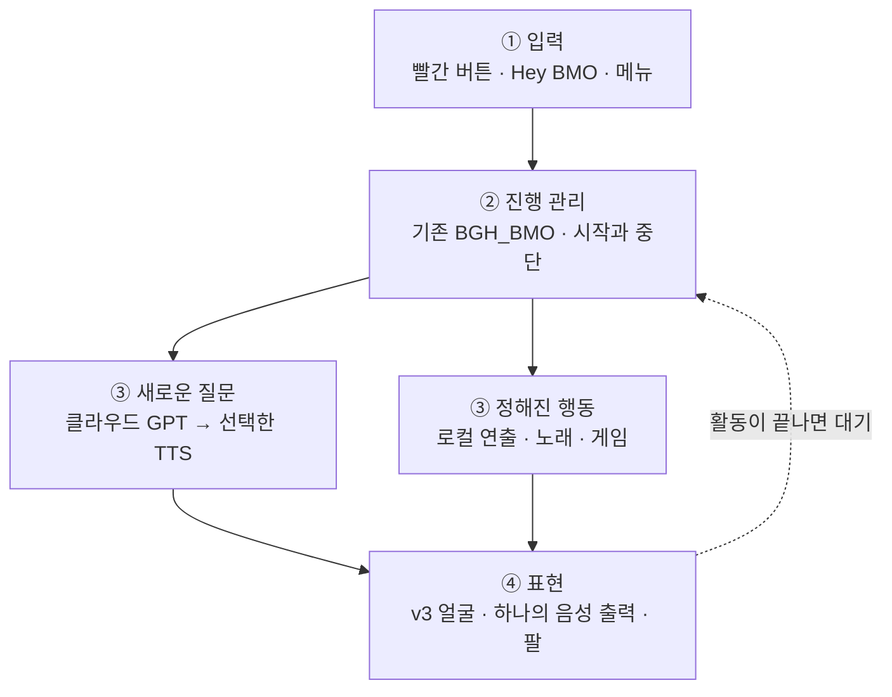
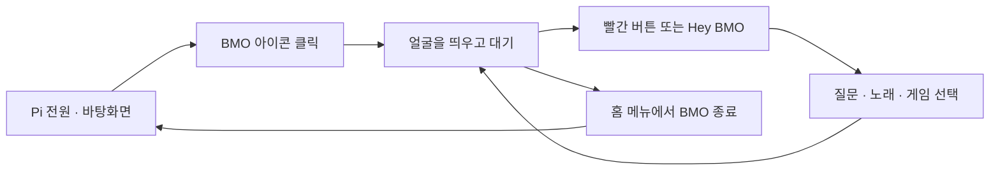

# BMO 작동 구조

**필요할 때 켜서, 부르고, 이야기하고, 함께 노는 BMO.**

[프로젝트 소개·제작 자료로 돌아가기](../README_KR.md) · [레퍼런스·게임 후보·노래 조사](BMO_REFERENCES_KR.md)

> **문서 기준: 2026-10-17**
> BMO의 사용 흐름과 구성 요소를 설명합니다. 아래의 목표 동작과 실제 구현 상태는 구분하며, 아직 검토 중인 버튼 배치·재생 경로·반응 설정을 포함합니다. 자동 테스트 통과가 실물 동작과 최종 사용성 검증을 대신하지는 않습니다.

## 한눈에 보는 작동 구조

**입력을 받고 → 필요한 일을 고르고 → 얼굴·소리·팔로 표현한다.** 기존 대화 프로그램이 이 흐름을 관리하며, 기능마다 새 BMO 프로그램을 따로 만들지 않습니다.



**이 그림은 목표 구조이지 구현 완료도가 아닙니다.** 음성으로 말한 질문·명령은 분기 전에 음성 인식(STT)을 거칩니다. 매 활동마다 얼굴·음성·팔을 모두 켠다는 뜻도 아닙니다. 게임 중에는 게임 화면과 조작이 우선하고, 듣기·생각하기는 주로 무음 얼굴로 표현합니다.

| BMO 앱 안 | BMO 앱 밖 |
|---|---|
| 바탕화면 아이콘으로 시작, 질문·메뉴·재생·팔 관리 | Pi 전원·팬·SSH·개인 웹서버는 독립 유지 |
| 종료하면 BMO가 사용한 자원만 정리 | BMO를 꺼도 다른 서버는 계속 사용 |

호출어와 빨간 버튼은 **같은 대화의 두 입구**, 초록은 확인·세모는 뒤로가기를 권장합니다. **팔은 사용 범위에 포함하고 IMU만 보류**합니다. 세부 동작과 아직 검토할 값은 아래 접힌 설명에 보존했습니다.

---

<details>
<summary><strong>상세 동작·버튼·연출·근거 펼치기</strong></summary>

[사용 흐름](#bmo를-켜서-끄기까지) · [대화 방식](#버튼으로도-hey-bmo로도) · [버튼](#누르기-편한-버튼-배치) · [표정과 팔](#얼굴과-팔로-반응하기) · [노래와 게임](#노래와-게임) · [내부 구조](#내부-구조는-이렇게-연결) · [현재 상태](#현재-구현-상태)

## BMO를 켜서 끄기까지

라즈베리파이는 개인 웹서버로도 사용할 수 있도록 계속 켜 둡니다. **BMO는 부팅 때 자동으로 시작하지 않고, 바탕화면의 BMO 아이콘을 눌러 따로 실행**하는 방향입니다. 실행하면 얼굴이 계속 대기하고, 질문·노래·게임을 마친 뒤에도 다시 그 얼굴로 돌아옵니다.



이 그림은 **목표 동작**입니다. BMO를 종료하면 녹음·재생·게임 등 BMO가 시작한 작업만 정리하고 바탕화면으로 돌아갑니다. **Pi 전원, 팬, SSH, 다른 웹서버는 유지**합니다. 아이콘을 여러 번 눌러도 앱은 하나만 실행되어야 합니다.

## 버튼으로도, “Hey BMO”로도

**대화의 입구는 두 개, 들어간 뒤의 처리는 하나**로 설계합니다. 빨간 버튼은 언제나 쓸 수 있는 확실한 입력이고, “Hey BMO!”는 손을 쓰지 않고 부르는 방법입니다. 호출어를 지원 범위에서 빼지 않습니다.

대기 중 호출어를 사용하도록 설정하면 Pi가 마이크 신호를 **로컬에서** 확인합니다. 부르기 전 주변 소리를 계속 클라우드 STT에 보내는 방식은 아닙니다. BMO 앱을 끄거나 호출어를 비활성화하면 이 감지도 멈춥니다. 호출어만 켜도 마이크는 로컬 처리에 쓰인다는 점은 화면에 표시합니다.

> **빨강 또는 “Hey BMO” → 녹음 준비 표시 → 질문 → 말 끝 감지 → 인식·생각 → 답변 재생과 입 동작 → 대기**

“Hey BMO, 오늘 뭐 할까?”처럼 이어 말할 때 앞부분이 잘리지 않도록 같은 오디오 흐름과 짧은 메모리 버퍼를 사용하는 설계입니다. 버튼과 호출어가 겹쳐도 한 번만 시작합니다. 기존 `wakeword.onnx`의 대상 문구·출처·성능은 검증 대상이며, 파일이 있다는 이유만으로 “Hey BMO” 인식 성능이 확인된 것은 아닙니다.

말 끝은 VAD로 감지하고 빨강을 다시 눌러 직접 제출할 수도 있습니다. **생각하거나 말하는 중 빨강은 현재 작업을 중단**합니다. 준비 표시가 나온 뒤 다음 누름으로 새 질문을 시작하며, 첫 중단 버튼이 곧바로 녹음을 켜지는 않습니다.

**음악·게임·BMO 자신의 발화 중에는 호출어를 기본적으로 쉬게** 합니다. 이때는 빨강으로 멈추거나 일시정지합니다. 자기 목소리를 다시 질문으로 받는 문제를 피하고, 완전한 음성 끼어들기는 별도 검증 대상입니다.

BMO가 “어떤 게임?”처럼 사용자에게 선택을 물었을 때만 짧게 답을 기다리는 후속 듣기를 검토합니다. 모든 대답 뒤 자동으로 마이크를 여는 방식은 기본으로 삼지 않습니다. 시끄러운 전시 장소에서는 호출어를 끄고 빨간 버튼만 사용할 수 있게 합니다.

<details>
<summary>대화 레퍼런스와 설정값</summary>

[Be More Agent](https://github.com/brenpoly/be-more-agent)의 호출어·상태별 얼굴/효과음 분리, [Home Assistant의 음성 파이프라인](https://contributors.home-assistant.io/architecture/platform/voice/)과 [버튼/호출어를 같은 흐름으로 받는 구조](https://contributors.home-assistant.io/core/entities/assist-satellite/)를 참고했습니다. 해당 프로젝트의 로컬 LLM이나 홈 자동화 전체를 가져오는 것은 아닙니다. BMO의 지능은 기존 클라우드 GPT를 유지합니다.

[openWakeWord](https://github.com/dscripka/openWakeWord)는 호출어와 VAD를 구분하고 환경별 오인식/누락 검사를 권장합니다. 엔진 후보이지 최종 선택이나 실제 성능 승인은 아닙니다. “헤이 비모”의 한국어 억양·거리·배경 대화에서의 성능도 미확인입니다.

초기 후보는 말 시작 대기 3초, 발화 후 무음 0.9초, 녹음 최대 10초입니다. 모두 조정 가능한 제안값이며, 불안정하면 버튼 시작/버튼 종료를 사용하는 설계입니다. 호출어 준비 버퍼가 음성 인식에 포함되는 범위도 검증 대상입니다. 후속 선택 대기는 화면에 명확히 표시하고 무응답이면 대기로 돌아갑니다.

취소는 로컬 재생 정지와 원격 요청 취소를 구분합니다. 취소 후 늦게 도착한 답변은 말하지 않으며, 이미 시작된 요청의 과금까지 취소됐다고 표시하지 않습니다.

</details>

## 누르기 편한 버튼 배치

**바깥쪽의 초록 원을 확인·선택으로, 파란 세모를 뒤로·취소로 쓰는 것을 권장**합니다. 가장 자주 누를 확인을 편한 위치에 두고, 빨강은 대화 역할을 유지합니다. 색·모양보다 실제 조작 편의가 기준이며 최종 배치는 사용성 검증 전입니다.

| 버튼 | BMO·메뉴에서 | 게임에서의 권장 역할 |
|---|---|---|
| **십자** | 항목 이동 | 이동 |
| **작은 초록 원** | 메뉴 열기·확인·선택 / 노래 재생·일시정지 | A: 주 행동·점프 |
| **파란 세모** | 뒤로·취소 / 길게 누르면 홈 | B: 보조 행동 / 길게 누르면 홈 탈출 |
| **빨간 원** | 질문 시작·녹음 제출·현재 답변 중단 | 일시정지. 게임 중 바로 녹음하지 않음 |

파란 세모 길게 → 홈 → 시스템 → **BMO 종료** → 초록 확인으로 닫는 안입니다. Pi 전체 종료는 이 버튼의 즉시 동작에 넣지 않습니다. 노래/게임에서 질문하려면 먼저 재생을 멈추고 준비 상태로 전환합니다.

기존 기록의 초록=Enter, 세모=Z는 앱에서 의미별로 매핑할 수 있습니다. **빨간 GP7의 기존 팔 토글과 목표 질문 버튼은 동작이 다릅니다.** 현재 펌웨어가 위 목표 배치를 구현한 것으로 간주하지 않습니다. 게임에서 길게 누르기가 B 입력과 겹치는 조작감도 검증 대상입니다.

## 얼굴과 팔로 반응하기

**기존 얼굴 디자인을 유지합니다.** v2의 비율·색·표정을 기준으로, v3의 부드러운 윤곽과 오디오 기반 입 움직임을 재사용하는 방향입니다. v3의 움직임까지 최종 사용성 검증을 마친 것은 아닙니다.

듣기·생각하기·깜빡임은 미리 만든 **로컬 무음 애니메이션**입니다. 짧은 인사·확인 안내는 준비된 클립을 사용할 수 있고, 새로운 질문은 GPT가 답합니다. 일반 대화를 대충 비슷한 예전 답으로 대체하지 않습니다. 같은 응답을 다시 들을 때만 현재 세션의 오디오 캐시를 재생합니다.

**팔은 통합 범위에 포함하고, IMU는 따로 보류**합니다. 양팔의 과거 작동 확인 이력과 새 연출의 각도·속도·타이밍 검증은 구분합니다.

| 장면 | 얼굴과 팔의 권장 연출 |
|---|---|
| 처음 인사 | 웃는 얼굴 + **BMO 자신의 오른팔을 한 번 들어 인사** |
| 기뻐하거나 성공했을 때 | 행복한 얼굴 + **양팔을 들어 만세** |
| 모른다고 답할 때 | 곤란한 얼굴 + 양팔을 작게 들어 으쓱하는 느낌 |
| 듣기·생각하기 | 얼굴만 움직이고 팔은 쉬기 |

팔은 문장마다 반복하지 않고 의미 있는 장면에서 한 번만 연기합니다. 정해진 이름의 제스처를 사용하며 GPT가 임의 각도나 PWM을 보내지는 않습니다. 기존 동작 범위와 새 제스처의 기구 간섭은 별도 검증 대상입니다. 팔이 한 축씩인 구조에 손목 흔들기 같은 존재하지 않는 자유도를 가정하지 않습니다.

**IMU가 없거나 불량이어도 팔 기능 전체를 막는 설계는 하지 않습니다.** 안정된 탁상 상태에서 팔을 쓰고, 들고 이동할 때는 운영자가 팔 동작을 끄는 방식입니다. 자동 들림/기울어짐 반응은 현재 미지원입니다. 앱 종료·재연결 때 무조건 팔을 끝까지 이동시키는 동작도 넣지 않습니다.

## 노래와 게임

### 노래는 로컬에서 바로 재생

“노래해 줘”라고 하면 등록된 노래를 고르고, 특정 제목을 말하면 해당 곡을 재생하는 방향입니다. 매번 유튜브를 열거나 TTS로 다시 노래를 만들지 않고, **미리 준비한 로컬 음원과 입 동작**을 사용합니다. 다운로드 대기와 새 합성 과정은 없앨 수 있지만 실제 재생 지연은 별도로 측정해야 합니다.

곡 수를 2곡으로 제한하지 않고, 원작에서 BMO가 직접 부른 곡을 가능한 한 빠짐없이 모으는 것이 목표입니다. 다만 BMO가 부른 곡, BMO가 틀어 놓은 다른 가수의 곡, 리믹스·팬 커버는 구분합니다. [확인한 곡과 출처](BMO_REFERENCES_KR.md#노래--곡수-제한-없이-원작-목록부터)는 별도 자료에 있으며, 목록 확인과 파일 확보는 다릅니다.

현재 음원 추출·다운로드·Pi 등록은 미완료입니다. 사용 가능한 경로로 확보한 파일과 곡별 입 타임라인을 등록하는 구조이며, 전시/공개 영상에서의 이용 조건은 별도로 확인해야 합니다. 원작 음원·가사·영상은 이 저장소에 통째로 공개하지 않습니다.

### 게임 선택과 복귀

“게임 하고 싶어” → 게임 목록 → 십자로 이동 → **초록으로 시작** → 빨강으로 일시정지 → 파란 세모로 뒤로/홈. 게임이 끝나면 BMO 얼굴로 돌아옵니다.

[Virtual BMO와 Guardians of Sunshine 비교·체험 링크](BMO_REFERENCES_KR.md#게임--사용자가-먼저-해볼-후보)는 별도 자료에 있습니다. 기존 팬 게임을 재사용하는 방향이며, 게임 채택·설치·Pi 호환성 검증은 미완료입니다. 게임 개수는 확정하지 않았습니다.

## 내부 구조는 이렇게 연결

**기존 Python 백엔드가 흐름을 관리하고, v3 얼굴·단일 음성 재생·팔 제스처를 함께 지휘**하는 구조를 목표로 합니다.

```text
빨간 버튼 / 로컬 Hey BMO 감지
             ↓
    하나의 대화·메뉴 관리자
       ├─ 새로운 질문 → 클라우드 GPT → 선택한 TTS
       └─ 반복 연출·노래·게임 → 등록된 로컬 콘텐츠
             ↓
      얼굴 + 하나의 재생 경로 + 팔
             ↓
            대기

팬·SSH·개인 웹서버는 BMO 앱 밖에서 독립 유지
IMU의 자동 반응은 현재 연결하지 않음
```

소리의 재생 담당은 하나입니다. **Pi 브라우저 재생**과 Python/ALSA 재생은 비교 중인 경로이며, MAX98357A 출력과 얼굴 동기화 검증 전입니다. 두 경로를 동시에 재생하지 않습니다. Windows 브라우저에서 재생한 소리가 자동으로 Pi에서 나는 것은 아닙니다.

API 키는 Python 쪽에만 두며, BMO 제어 서버와 향후 인터넷 공개 웹서버는 포트·권한·파일을 분리합니다. 호출어 감지, 메뉴, 팔, 노래 재생에 클라우드 LLM은 필요하지 않습니다. 음성으로 명령했다면 STT 비용은 발생할 수 있습니다.

<details>
<summary>구성 요소와 참고 프로젝트</summary>

`BGH_BMO`는 대화 문맥·오류 처리·취소·상태 큐를 담당합니다. v2는 얼굴 디자인의 기준이며, v3는 연속 윤곽과 오디오 기반 입 움직임을 구현한 별도 프로토타입입니다. PNG 렌더러는 진단용 화면으로 구분합니다. Lab은 얼굴·음성 실험 패키지이며 별도의 두 번째 영구 대화 엔진으로 함께 운영하는 구조는 아닙니다.

[Reachy Mini conversation app](https://github.com/pollen-robotics/reachy_mini_conversation_app)의 대화와 안무 동작 분리를 참고했습니다. 하드웨어·각도·대화 제공자를 그대로 사용하는 것은 아니며, BMO의 로컬 정책이 동작 중복과 우선순위를 관리하는 방향입니다. 질문/중단이 낮은 우선순위의 자율 연출보다 먼저입니다.

</details>

## 현재 구현 상태

| 구분 | 확인된 것 | 미완료·미검증 범위 |
|---|---|---|
| 하드웨어 | 화면, RP2040 버튼·양팔의 개별 동작 이력; 독립 팬 설정 | 새 버튼 배치·새 팔 연출·전체 운용 안정성 |
| 얼굴 | v2/v3 원본과 PNG 기반 데모 존재 | 최종 얼굴 움직임·음색·립싱크의 사용성 검증 |
| 대화 | 클라우드 대화 코드와 과거 음성 시험 이력; 야간 모의 통합 | 호출어·v3·팔까지 연결한 최종 앱 |
| 자동 검사 | 야간 보고서에 169개 회귀 + 8개 화면 검사 통과 기록 | 실제 사용성과 최종 사용자 승인 |
| 콘텐츠 | 게임·노래 출처 조사 | 전체 음원 목록 확정·음원 확보·게임 채택·Pi 등록 |
| IMU | 이상 진단 기록 | 정상 센서로 활용하기 — 보류 |

개발 코드는 [feature/bmo-robust-conversation](https://github.com/GUNOBAE/BGH_BMO/tree/feature/bmo-robust-conversation)에 있습니다. [야간 보고서](https://github.com/GUNOBAE/BGH_BMO/blob/a2f895ea9f078c655f0db1a17d704008bbde7bb5/docs/reports/NIGHTLY_STATUS.md)의 `COMPLETED`는 해당 소프트웨어 작업 범위를 뜻합니다. 모의 테스트와 짧은 데모 실행은 전체 BMO의 실물 통합이나 사용자 승인 완료를 의미하지 않습니다.

</details>
