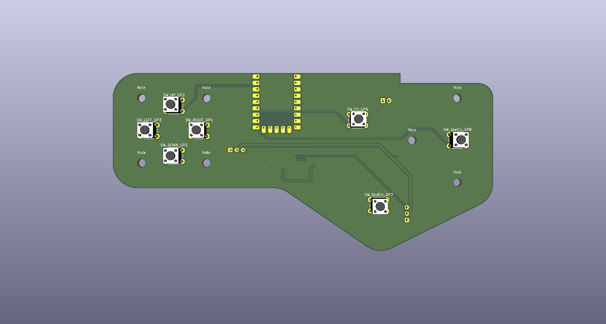
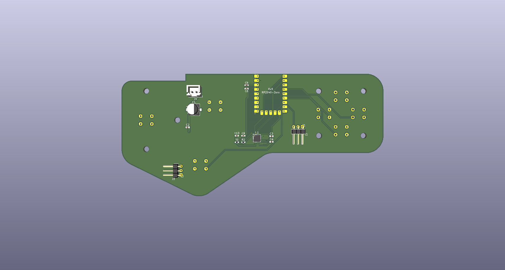
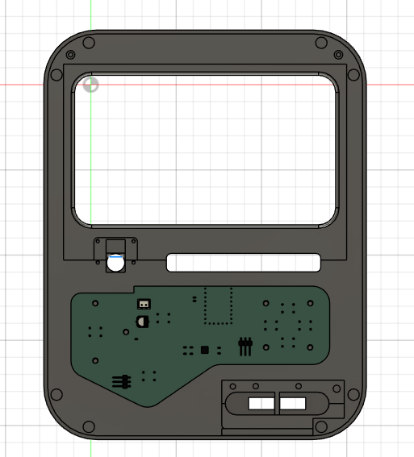
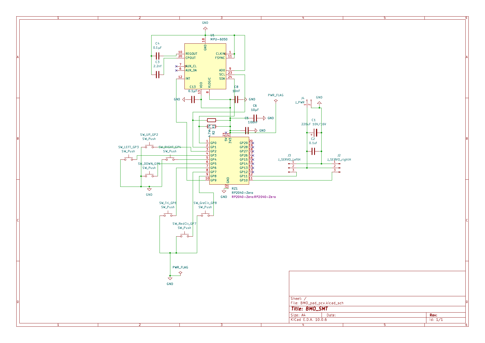

# BMO 맞춤형 PCB

[← 프로젝트 소개](../README_KR.md)

7인치 BMO의 전면 버튼, 자세 센서, 양팔 서보를 한 장에 연결하기 위해 **KiCad로 설계한 RP2040-Zero 기반 PCB**입니다. PCBWay에서 제조와 SMT 실장을 진행한 기판을 수령했고, RP2040 버튼·양팔의 개별 동작 시험 이력이 있습니다. 새 대화 버튼 배치와 팔 제스처의 전체 연동은 검수 전이며, MPU-6050은 이상 진단 기록 때문에 사용을 보류합니다.

> **상태 기준: 2026-10-22 KST.** 아래 제조 자료는 설계·발주 이력을 보존한 것입니다. 개별 동작 시험과 새 BMO 앱의 전체 통합 검수는 구분하며, 현재 연결 계획은 [통합 기준 문서](development/BMO_INTEGRATION_2026-10-22_KR.md)에 정리합니다.

| 전면 3D 뷰 | 후면 3D 뷰 |
|:---:|:---:|
|  |  |

*KiCad에서 내보낸 PCB 설계 이미지입니다. 수령한 실물의 사진과 시험 결과는 별도로 기록합니다.*

## 목차

- [역할과 연결](#역할과-연결)
- [회로 구성과 핀 배치](#회로-구성과-핀-배치)
- [제조 및 실장](#제조-및-실장)
- [설계 및 제조 파일](#설계-및-제조-파일)
- [조립 및 검증 현황](#조립-및-검증-현황)
- [레퍼런스](#레퍼런스)

## 역할과 연결

| 구역 | 구성 | 역할 |
|---|---|---|
| 상위 제어 | Raspberry Pi 5 8GB | 화면과 상위 프로그램 실행, RP2040-Zero와 USB 연결 |
| 입력 | 방향 버튼 4개, 기능 버튼 3개 | BMO 전면의 물리 입력 |
| 자세 | MPU-6050 | RP2040 측 센서 입력. 이상 진단으로 현재 사용 보류 |
| 구동 | 좌·우 서보 커넥터 | 양팔 서보의 제어 신호 연결 |
| 서보 전원 | 별도 2핀 전원 커넥터 | 서보 전원을 외부에서 공급하도록 설계 |

서보 전원은 RP2040-Zero의 전원 경로와 분리해 설계했습니다. 새 팔 제스처를 연결할 때는 실제 전원 배선·공통 접지와 기구 간섭을 회로도 및 실물 기준으로 확인합니다. 개별 서보 시험 이력만으로 새로운 각도·속도·연속 동작의 검수가 끝난 것은 아닙니다.

*Fusion 360에서 본 PCB 배치. 화면 개구부 아래에 PCB가 놓이는 위치를 보여줍니다. 실제 조립 사진은 별도로 기록합니다.*

## 회로 구성과 핀 배치

아래 핀 이름은 보유 중인 KiCad PCB·부품 목록의 버튼 레퍼런스 및 연결 넷을 기준으로 정리했습니다. 펌웨어에 반영할 때는 최종 제조에 사용한 회로도와 대조해 주세요.

| RP2040-Zero 핀 | 연결 대상 |
|---|---|
| GP0 / GP1 | MPU-6050의 I²C 데이터(SDA) / 클록(SCL) |
| GP2 / GP3 / GP4 / GP5 | 위 / 왼쪽 / 오른쪽 / 아래 버튼 |
| GP6 / GP7 / GP8 | 삼각형 / 빨간 원 / 초록 원 버튼 |
| GP9 | MPU-6050 인터럽트(INT) |
| GP10 / GP11 | 오른팔 / 왼팔 서보 신호 |

MPU-6050은 Pi의 GPIO I²C에 직접 연결된 센서가 아닙니다. RP2040-Zero가 읽은 데이터를 Pi에 전달하는 구조로 연결해야 합니다. 또한 **빨간 GP7의 기존 팔 토글과 새 질문·중단 버튼 제안은 서로 다르므로**, 위 핀맵을 새 대화 기능이 구현됐다는 뜻으로 해석하지 않습니다.

### 회로도

이미지를 누르면 [원본 회로도 PDF](../hardware/pcb/BMO_pad_pcv_schematic.pdf)를 열어 확대해서 볼 수 있습니다. 회로를 수정하려면 아래의 KiCad 원본 파일을 사용하세요.

## 제조 및 실장

PCBWay의 협찬으로 PCB 제조와 SMD 부품 실장을 진행했습니다. 아래 표는 업체 SMT와 직접 납땜할 관통홀 부품을 나눈 **제조 당시의 작업 구분**입니다. 현재 기판은 수령한 상태이며, 이 표가 부품별 납땜 품질 검수 완료를 의미하지는 않습니다.

| 구분 | 부품 | 수량 / 비고 |
|---|---|---|
| 업체 SMT | MPU-6050 `U1` | 1개 |
| 업체 SMT | 저항 `R1`, `R2` | 4.7 kΩ, 각 1개 |
| 업체 SMT | 커패시터 `C1`, `C2`, `C3`, `C4`, `C5`, `C6`, `C8`, `C13` | C1은 220 µF, 16 V, 6.3 × 5.4 mm SMD형으로 발주한 내용 확인 |
| 직접 납땜 | RP2040-Zero `RZ1` | 1개 |
| 직접 납땜 | 전면 푸시 버튼 | 7개 |
| 직접 납땜 | 오른팔·왼팔 서보 헤더 `J2`, `J3` | 각 1개 |
| 직접 납땜 | 서보 전원 커넥터 `J4` | 1개 |

부품 목록의 `DNP` 표시는 업체 SMT에서 제외하고 직접 장착할 부품을 뜻합니다. 실제 업체 생산 BOM·실장 좌표 파일과 KiCad 내보내기 파일의 최종 리비전 대조 결과는 아직 이 문서에 기록되지 않았습니다.

> **추가하면 좋은 사진:** 도착 직후 기판 앞·뒷면 사진과 SMD 실장부 확대 사진. 직접 납땜한 뒤에는 같은 각도로 한 번 더 촬영해 실장 전후를 비교하면 좋습니다.

## 설계 및 제조 파일

제공받은 KiCad 프로젝트와 Gerber ZIP을 비교해 두 압축파일의 제조 데이터가 일치함을 확인한 기록이 있습니다. 작업 이력과 잠금 파일을 제외한 자료를 아래에서 내려받을 수 있습니다. 이 파일 비교와 실제 PCBWay 생산 자료의 최종 리비전 대조, 새 BMO 앱과의 통합 검수는 별도입니다.

- **[KiCad 설계·BOM·실장 좌표·STEP 묶음 다운로드](../hardware/pcb/BMO_pad_pcv_source.zip)**
- **[제조용 Gerber·드릴 파일 다운로드](../hardware/pcb/BMO_PAD_GBR.Zip)**

| 파일 | 용도 |
|---|---|
| `BMO_pad_pcv.kicad_sch` | 편집 가능한 KiCad 회로도 |
| [`BMO_pad_pcv_schematic.pdf`](../hardware/pcb/BMO_pad_pcv_schematic.pdf) | 전체 회로도 열람용 PDF |
| `BMO_pad_pcv.kicad_pcb` | 편집 가능한 KiCad PCB 레이아웃 |
| `BMO_pad_pcv.kicad_pro` | KiCad 프로젝트 설정 |
| `BMO_pad_pcv.csv` | 부품 목록(BOM) |
| `BMO_pad_pcv-all-poss.csv` | 부품 실장 위치·회전·면 정보 |
| `BMO_PAD_GBR.Zip` | 제조용 Gerber 10종, 드릴 파일 2종 등의 묶음 |
| `BMO_pad_pcv.step` | PCB 3D 형상 |

`*.kicad_prl`, `.history/`, `_restore_backup_*`, `*.lck`는 개인 작업 환경과 복구 이력이므로 배포용 묶음에서 제외했습니다. 재제조할 때는 **회로도·PCB·BOM·실장 좌표·Gerber가 같은 리비전**인지 확인해야 합니다.

> **추가하면 좋은 사진:** 수령한 기판의 리비전 표기가 보이는 확대 사진. 설계 파일과 수령품을 대조하기 쉽습니다.

## 조립 및 검증 현황

| 항목 | 확인된 이력 | 남은 확인 |
|---|---|---|
| 기판 | PCB 수령, RP2040·버튼·양팔 개별 시험 이력 | 생산 리비전 대조와 실물 조립 기록 정리 |
| 버튼 | 기존 HID 입력 시험 이력 | 초록 확인·세모 뒤로·빨강 질문/중단 제안과 기존 GP7 팔 토글 충돌 해결 |
| 양팔 | 좌·우 서보 개별 동작 시험 이력 | 새 제스처 각도·속도·기구 간섭·취소 동작 검수 |
| MPU-6050 | 정지 상태 편향·자체 시험 실패 등 이상 진단 기록 | 원인과 정상 동작 확인 전까지 사용 보류 |
| Pi 연동 | 기존 USB 연결 이력, 호스트 측 통신 계약 초안 | 현재 펌웨어·실제 통신 형식·새 명령 결과 전달 검증 |

**팔 통합과 IMU 보류는 별도로 진행합니다.** 안정된 탁상 상태에서 검증한 팔 제스처부터 연결하고, IMU에 의존하는 자동 들림·기울임 반응은 사용하지 않습니다. 현재 Action v0의 가상 실행 결과는 실제 팔 동작이나 사진·게임 실행 성공을 뜻하지 않습니다.

호스트의 JSONL 통신 계약은 아직 현재 RP2040 펌웨어가 전송한다는 확인이 없는 제안입니다. 과거 진단 당시에는 기존 펌웨어 재시작으로 팔이 움직일 수 있다는 기록도 있으므로, 실제 연결 전에 장치의 현재 상태와 펌웨어를 확인해야 합니다. 과거의 정지·연결 상태가 지금도 유지된다고 가정하지 않습니다.

기존 상태와 이상 진단의 근거는 [현재 프로젝트 기록](../README_KR.md#조립-및-검증)과 [2026-10-13 하드웨어 관찰·진단을 보존한 문서](https://github.com/GUNOBAE/BGH_BMO/blob/b346cc3017ca0ee4cb2162384d1fa1499659739a/docs/hardware.md)를 참고합니다. 이 문서 갱신에서 하드웨어 시험을 다시 수행한 것은 아닙니다.

시험 중 발견한 문제와 수정은 메인 문서의 [Troubleshooting & Design Changes](../README_KR.md#troubleshooting--design-changes)에 기록하겠습니다.

> **추가하면 좋은 사진·영상:** 납땜 완료된 기판, Pi와 PCB의 USB 연결 및 서보 전원 배선, 버튼 반응과 양팔 서보 동작을 보여주는 짧은 영상. 테스트 결과 표는 실제 측정한 뒤 채웁니다.

## 레퍼런스

- **MPU-6050 센서:** InvenSense, [*MPU-6000/MPU-6050 Product Specification*, Revision 3.4 (2013-08-19)](https://product.tdk.com/system/files/dam/doc/product/sensor/mortion-inertial/imu/data_sheet/mpu-6000-datasheet1.pdf). `U1`의 핀 배치, I²C 인터페이스, 전원 및 PCB 설계 조건을 확인할 때 참고한 제조사 문서입니다.
