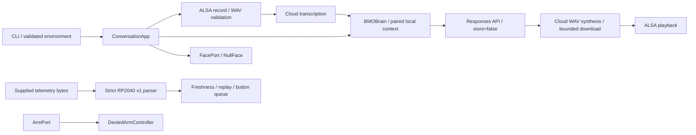

# Conversational architecture

The host runs a single synchronous push-to-talk/text loop. Explicit input starts
one turn, which completes before another recording can begin. This keeps speaker
feedback out of the microphone by construction and makes cloud costs observable.
It does not implement acoustic echo cancellation or Realtime interruption.

Telemetry/camera contracts are separate extension points; they are not connected
to the current CLI or GPT prompts. The diagram shows dependencies, not claims
that physical adapters exist or that the proposed telemetry matches firmware.

## Responsibilities

| Module | Responsibility | External effects |
| --- | --- | --- |
| `config.py` | Frozen settings, bounds, startup speech validation | Reads supplied/process BMO variables only |
| `cloud.py` | Lazy SDK client, official API origin, safe error classification | Cloud calls only through an explicitly created client |
| `core.py` | English/Korean policy, bounded paired history, transactional response validation | Responses request; no hardware effects |
| `audio.py` | ALSA inventory/record/playback, PCM validation, STT/TTS, temporary file cleanup | Explicit ALSA processes, temporary files, speech API requests |
| `app.py` | Voice input, GPT reply, speech and optional face-state dispatch | Uses injected brain/client/config/face; no camera/controller access |
| `__main__.py` | Commands, lifecycle, error recovery, modes | Interactive input/output; closes SDK resources |
| `telemetry.py` | Structured events, private log rotation, monotonic stage timing | stderr and optional event file |
| `hardware.py` | Typed extension contracts, parse-only RP2040 telemetry, safe arm denial | None; never opens device nodes |
| `diagnostics.py` | Proc/sysfs metadata and executable presence | Read-only descriptive files; no device opens |
| `benchmark.py` | Bounded mock host-overhead measurement | No network/device operations |

## Conversation transaction

Before a request, the brain validates raw input length and trims old complete
user/assistant pairs to both turn and character budgets. Current user input is
never silently truncated. The outgoing context begins with a user message and
ends with the current user, without an orphaned assistant reply.

Each Responses request includes the persona/language instruction, bounded input,
`max_output_tokens`, and `store=False`. The host maintains context rather than
using provider response IDs or persistent conversations. A completed nonempty
text response commits a new pair. Empty, failed or incomplete responses and
network errors leave the previous local history unchanged. A pair too large for
the configured retention budget is not partially retained. `/reset` clears
history and the last reply without a request.

This session is intended for one application loop, not concurrent callers. A
future asynchronous UI must serialize brain access and handle cancellation before
committing. No tools are supplied to GPT, and GPT output is never evaluated as a
hardware command. The persona does not claim unavailable observations/actions.

## Voice turn and error recovery

1. An empty Enter in voice mode sets the face to `LISTENING` and records a bounded
   mono 16-kHz, 16-bit WAV through the explicitly configured or existing default
   PCM. Invalid containers/lengths fail before upload.
2. Transcription uses automatic language detection for English/default and auto
   modes, or a Korean hint when Korean is selected. Recording cleanup runs even
   after an interrupt; a cleanup error preserves the primary failure.
3. `THINKING` accompanies the GPT request. The answer appears on screen before
   synthesis/playback, so speech errors do not lose a completed conversation.
4. `SPEAKING` accompanies WAV synthesis and playback. Download is capped at 24
   MiB and checked against a cooperative 60-second deadline at native chunk
   boundaries. Validated actual PCM bytes determine the playback timeout.
5. Failures set `ERROR`, report a fixed safe category/message, then return to
   `IDLE` at the next prompt. A broken optional face sink cannot stop conversation.

`/repeat` displays the last completed reply and, in unmuted voice mode,
re-synthesizes/replays it without another GPT or microphone request. Synthesis
still incurs its usual API cost. Muted/text modes skip speech generation entirely.

The SDK owns request retries (default one); neither core nor audio adds another
loop. Phase/read timeouts and streaming chunk checks are finite controls, not a
strict total-turn deadline. A timed-out server may already have processed a
request. Avoid increasing retry budgets to hide outages. Cloud errors do not
print response bodies, keys, prompts or raw SDK exceptions.

## Hardware extensions

The current face sink only holds local state. `FacePort` can later accept a
renderer that owns its display resources and returns quickly. `CameraPort`
requires bounded capture and explicit close; no camera driver is imported and no
image is sent to GPT. `IMUPort`/`ButtonPort` expose typed observations with host
monotonic freshness, rather than shared raw serial strings.

The RP2040 JSON decoder accepts only a proposed versioned observation schema,
finite physical-range values, exact fields, bounded lines and bounded input
chunks. It recovers after malformed/oversized lines and rejects duplicate or
backwards sequences. No transport exists; opening/resetting the current console
can interfere with firmware and cause arm movement. The existing MPU6050 has
fault evidence and its measurements are quarantined from control decisions.
`DeniedArmController` rejects every movement request; configuration cannot unlock
it. See [hardware contracts](hardware.md) for the schema and supervised integration
requirements.

## Validation and observability

Standard-library unit tests inject API, ALSA, face, clock and filesystem fakes.
Real SDK contract tests use HTTPX MockTransport, preserving actual serialization,
response parsing, streamed WAV consumption and SDK retry behavior without network
calls. A harmless Python child exercises timeout killing/reaping; no hardware
process is used by tests. Read-only host inventory verifies registration and
visibility only.

Event logs include timestamps, fixed events, outcome categories and monotonic
stage durations. Raw transcript/audio/provider bodies are excluded. Private
rotation keeps 0600 permissions on current and rotated files. SDK debug output
cannot propagate into terminal/global loggers through this application's setup.
The benchmark is explicitly mock-only and does not estimate live cloud latency.
