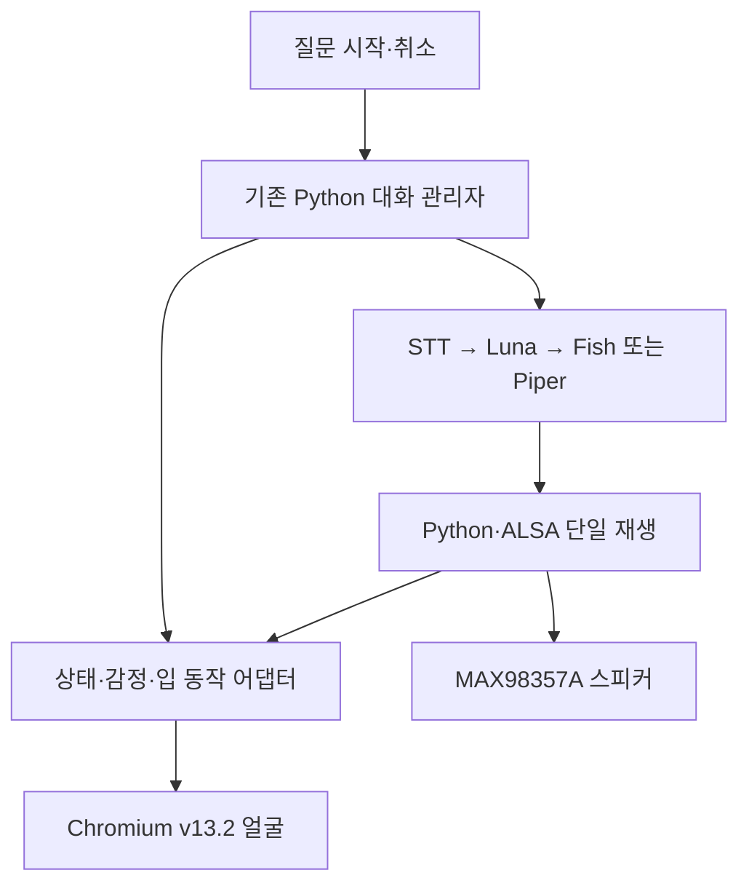

# BMO 통합 기준과 실행 순서

기준일: **2026-10-22 KST**

> **현재 상태: Pi 현황 점검과 보고서 검토 완료.** [2026-10-22 02:48–02:58 KST 현장 보고서](https://github.com/GUNOBAE/BGH_BMO/blob/0bfb8bd4b4d99bffb9ba479eab6b8b7f62ac25b4/docs/reports/PI_PREFLIGHT_LATEST_KR.md)를 직접 읽고 업로드 커밋이 보고서 한 파일만 추가했음을 확인했다. 다음 작업은 승인 얼굴의 Pi 전달·해시 확인과 격리된 1차 통합 개발이다. 아래는 그 작업의 기준이며, 이번 보고서 검토에서 코드 병합이나 장치 실행을 수행한 것은 아니다.

## 결론부터

**첫 통합의 목표는 승인된 v13.2 얼굴이 실제 음성 대화에 맞춰 듣고, 생각하고, 말하고, 멈추는 BMO 한 개를 만드는 것이다.**

| 지금 할 일 | 다음에 붙일 일 | 별도 유지할 일 |
|---|---|---|
| v13.2 + 기존 Fish 대화 경로 + 재생/입 동작 + 취소 | 물리 질문 버튼, Action v0 연결, 게임·노래·사진, 검증한 팔 제스처 | IMU 진단, 콘텐츠 추가 수집, 개인 서버 |

**두뇌는 사용자가 선택한 Luna low, 목소리는 Aaron Soft, 로컬 백업은 원본 Piper를 기준으로 한다.** 실제 코드의 기본값과 현재 Pi 실행 설정은 별도로 확인한다. 기존 GPT-4.1 mini 실행은 비교·복구 기준으로 보존한다.

사용자에게 필요한 첫 결과는 새 기능 목록이 아니라 **대기 → 듣기 → 생각 → 음성과 입 동작 → 대기**, 그리고 중간에 멈출 수 있는 한 흐름이다.

- 제품 사용 설명: [BMO 작동 구조](../BMO_OPERATION_PLAN_KR.md)
- 완료한 점검의 절차: [Codex Pi 현황 점검과 GitHub 보고](CODEX_PI_PREFLIGHT_KR.md)
- 준비된 다음 개발 작업: [Codex 1차 통합 작업서](CODEX_INTEGRATION_STAGE1_KR.md)
- 말투·언어·행동 정직성: [대화·음성 운용 규칙 v1](https://github.com/GUNOBAE/BGH_BMO/blob/707c66b8876130be75ad216fa10aaabf2bdcdb56/docs/voice-policy-v1/README_KR.md)

이 문서는 확인 가능한 이전 대화의 최신 결정, GitHub 실제 코드/PR, 최종 얼굴·게임 파일을 대조했다. 모든 과거 대화 원문이나 Pi의 현재 디스크·프로세스를 실시간으로 확인한 것은 아니다. **이번 변경은 문서 정리이며, 로봇의 실행 코드 배포나 실물 통합 완료를 뜻하지 않는다.**

### Pi 보고서 검토로 확정된 출발점

| 항목 | 이번 현장 보고서와 검토 결과 | 후속 처리 |
|---|---|---|
| 기존 음성 폴더 | `/home/bgh/BGH_BMO`, Piper 브랜치 `7bed6d02`, clean | 현재 폴더·설정·복귀 경로 보존 |
| Luna 폴더 | `/home/bgh/BMO_LUNA_AB`, `054ced8f`, tracked 변경 없음. 미추적 `logs/voice_41.jsonl`, `logs/voice_luna.jsonl` 존재 | 새 통합 폴더의 소스 기준. 두 로그는 수정·이동·업로드하지 않음 |
| Action 폴더 | `/home/bgh/BGH_BMO_ACTIONS`, v0 `b346cc30`, clean | 5개 Mock 계약 보존. 첫 얼굴·음성 연결 뒤에 적용 |
| 음성 선택 | Luna low/Fish Aaron Soft/beemo/gain 0.25는 유지. 이번 실행 적용값은 미확인 | 선택을 다시 요구하지 않고 새 통합 실행기에 명시. `.env`만 작성해서 적용 완료라고 하지 않음 |
| Piper | 원본 ONNX·JSON·실행 파일과 현재 해시 확인 | 원본 보존. 별도 백업 사본의 현재 존재·동일성은 미확인으로 유지 |
| 최종 얼굴 | Pi 한정 탐색에서 정확명 미발견. ChatGPT가 확보한 승인 HTML/ZIP은 위 기준 해시와 재대조 완료 | 승인 HTML 한 개를 Pi에 비공개 전달하고 경로·해시 확인. 이전 시안 대체나 재디자인 없음 |
| 연결 코드 | 얼굴 브리지·입 이벤트·재생 중 즉시 취소·새 언어 정책 적용 미구현 | 아래 Stage 1 개발 범위. 사용자에게 해결할 준비물로 넘기지 않음 |

Piper 음성 fallback과 별도의 모델 파일 백업은 다른 개념이다. 이번에 `/home/bgh/BMO_backups` 내부를 확인하지 않았으므로 백업이 없다고 결론 내리지 않는다. 표준 `.env`나 식별 가능한 실행 프로세스가 없었다는 관찰도 기존 실음성 성공을 취소하지 않는다.

다음 개발 전에 HEAD·dirty 상태·작업 지침의 변동만 재확인한다. 같은 전체 preflight를 반복할 필요는 없다. 게임 패키지·RP2040·카메라·팔·IMU는 첫 얼굴·음성 코드 연결의 선행 조건이 아니다. 실제 장치 검수는 별도 단계로 남긴다.

## 1. 확정된 것과 실제 완성도를 나눠 보기

| 부분 | 확정된 방향·확인된 결과 | 아직 남은 일 |
|---|---|---|
| 얼굴 | `BMO_Screen_v13_2.html`, 10월 21일 사용자 최종 시각/동작 승인. 원본·ZIP 실제 확보 및 대조 | Pi 원본 전달·해시 확인, 음성 이벤트 연결, 실제 화면·오디오 동기화 |
| 메인 대화 | 클라우드 GPT/STT + Fish의 Pi 대화 성공 이력. Luna low 실음성 비교 후 사용 선택. Pi 체크아웃 SHA 대조 완료 | 통합 실행 프로필에 선택 반영, 실제 유효 설정·장치 경로 검수 |
| 메인 목소리 | Fish Aaron 한 목소리, `soft`, `beemo`, PCM gain `0.25` | 통합에서 같은 출력 유지, 오류·중단 검수 |
| 대화 규칙 | 별도 프롬프트·언어 정책·20개 검수 사례가 GitHub에 작성됨 | 런타임 적용과 실제 청취/대화 검수. 사례 작성은 통과 결과가 아님 |
| 로컬 백업 | Piper 원본 ONNX/기본 추론 설정 선택, 음색 보정 실험 종료 | opt-in 자동 장애 전환을 Pi에서 검증. 오프라인 두뇌/STT는 없음 |
| Action v0 | 5개 명령 검증·중복 방지·Mock 결과, GitHub push와 CI 성공 | GPT/대화 흐름 연결, 각 실제 실행 어댑터 |
| 게임 | `BMO_Games_v3.zip`: 메뉴·런처·패드 설정·연동 시험용 Tetris 포함 | 원작 팬게임/ROM/다른 원본 확보, Pi 패드 검수, 얼굴 복귀 연결 |
| 버튼·양팔 | RP2040 기반 개별 동작 시험 이력 | 새 질문/취소 매핑, 실제 통신, 제한된 제스처 검수 |
| IMU | RP2040에 연결된 MPU6050. 과거 이상 진단 기록 | 별도 진단·수리/교체 판단. 자동 반응은 보류 |
| 노래·카메라 | 로컬 노래 재생과 Camera Module 3 Wide 촬영이 목표 범위 | 실제 음원·타임라인 확보, 카메라 저장/실패/완료 연결 |
| 실행·종료 | Pi는 계속 켜 두고 BMO는 바탕화면 아이콘으로 수동 실행하는 방향 | 통합 launcher·아이콘·중복 실행 방지·종료 검수 |

177개 등 과거 테스트 수는 당시 브랜치의 보고서다. 현재 모든 기능이 실물에서 통과했다는 뜻으로 합산하지 않는다. 이번 문서 작업에서는 모델/API 호출, 마이크 녹음, 오디오 재생, 펌웨어 변경, 팔 구동을 하지 않았다.

## 2. 앞으로도 보존할 기준

### 화면

최종 기준은 **v13.2 한 개**다. 이전 v2/v3/v7/v11 등의 문서는 역사 자료다. v13.2의 비율·색·표정·깜빡임·시선·울음·놀람 눈·말하기 동작을 통합을 이유로 다시 디자인하지 않는다.

원본을 그대로 두고 외부 wrapper/adapter로 연결한다. 과거 개인 검토용 원본의 공개 업로드 제외 방침을 유지하여, 이번 공개 문서에는 파일명·체크섬·연결 계약만 기록한다.

### 음성과 대화

| 항목 | 통합 기준 | 현재 코드와 구분할 점 |
|---|---|---|
| GPT | `gpt-6-luna`, `reasoning.effort=low` | 사용자 선택. 기존 코드 기본은 `gpt-4.1-mini`, 자동 배포된 상태 아님 |
| STT | `gpt-4o-mini-transcribe` 기존 경로 | 호출어나 오프라인 STT가 이미 연결된 것은 아님 |
| TTS | Fish Aaron reference `106f41ea392c4cc48c6eee76f69ff17e` | 현재 `tts_provider` 기본은 `openai`; 통합 프로필에서 Fish를 명시 |
| Fish 엔진 | 사용자가 시험한 `s2.1-pro-free` 설정 | 현재 무료 기간·가용성 보증이 아님. 자동 유료 승격 없음 |
| 연기·발음 | `soft`, `beemo` | 감정마다 성우를 바꾸지 않음. 승인된 `Bee-mo`는 대안 |
| 출력 게인 | PCM 진폭 `0.25` | 코드 기본 `0.30` 및 로컬 청취 시험 50%와 구분. 시스템 볼륨·출력 전력의 25%가 아님 |
| Piper | 원본 `en_US-bmo_voice.onnx`, 기본 추론 | 영어 음성 예비용. 새 피치/변동성 보정은 종료 |

말투는 다정하고 호기심 많고 조금 장난스럽게, 평소 1~2문장·영어 약 10~35단어를 목표로 한다. 정확한 답을 먼저 하며, 질문을 회피하거나 매번 농담·추가 질문을 붙이지 않는다. 이 ChatGPT 대화의 HO 호칭·욕설 캐릭터는 BMO에게 이식하지 않는다.

새 `english_voice` 정책은 한국어 질문도 이해하면서 기본 발화는 영어, 한국어 요청 시 한국어로 전환하는 설계다. 기존 `language=en`은 한국어 입력에 한국어로 답하는 지침이므로 **그대로 두고 프롬프트만 덧붙이면 충돌한다.** 이 이름들은 설계상의 정책이며 현재 CLI에 존재하는 옵션이라고 쓰지 않는다. 정확한 문구와 검수 사례는 위 음성 정책 한 곳에서 관리한다.

Luna와 4.1 mini의 실음성 비교는 각 1회였다. 사용자 선택은 존중하되, 그 한 번의 지연 차이로 보편적 속도·품질 우월성을 주장하지 않는다. 말끝, 녹음 종료, 첫 텍스트, 플레이어 시작, 실제 가청 시작은 다른 측정 지점이다.

### 본체와 운용

| 구성 | 현재 기준 |
|---|---|
| 메인 | Raspberry Pi 5 **8GB**, Debian 13 trixie, aarch64, Python 3.13.5라는 사용자 실행 기록 |
| 저장 | NVMe SSD **1TB**, microSD **512GB** |
| 화면 | 7인치 DSI, 과거 Pi 기록의 800×480 / Wayland·labwc. 현재 세션에서 재조회하지 않음 |
| 오디오 | **USB 마이크** 입력, **MAX98357A I2S 앰프+스피커** 출력 |
| 제어 보드 | **RP2040-Zero**. Raspberry Pi Zero가 아님 |
| IMU | MPU6050 SDA=GP0 / SCL=GP1 / INT=GP9, RP2040 측 센서 |
| 팔 | 오른팔·왼팔 각 1서보. 설계상 GP10/GP11 |
| 게임 입력 | USB 레트로 게임패드 |
| AI | 가속기 제거, 클라우드 API 중심. Piper가 로컬 두뇌를 대신하지 않음 |

Pi 전원과 BMO 앱의 시작·종료를 분리한다. BMO를 닫아도 팬, SSH, 별도 서버는 유지한다. 부팅 자동 실행으로 임의 전환하지 않는다. 앱은 하나만 실행하며 마이크·오디오·화면·게임의 소유권을 관리한다.

본체 버튼의 기존 권장 배치는 **초록=확인/A, 파란 세모=뒤로/B, 빨강=질문/중단**이다. 최종 실물 매핑은 미검수이며 GP7의 기존 팔 토글과 충돌한다. USB 패드와 본체 버튼, RetroArch의 버튼 번호를 같은 것으로 취급하지 않는다.

**팔은 통합 범위에 포함하고 IMU만 별도로 보류한다.** 안정된 탁상 환경에서 검증한 제스처부터 연결한다. 고장난 IMU 때문에 팔을 영구 제외하지 않으며, 반대로 현재 mock/차단 코드가 있다는 이유로 실제 팔을 이미 제어할 수 있다고 하지도 않는다.

## 3. 첫 통합 구조 — 구현 기준

**기존 Python 대화·재생을 유지하고, Chromium에서 승인된 얼굴만 표시한다.** 첫 구현은 기존 검증 경로를 재사용하는 방향이다.

`ConversationApp`, `BMOBrain`, `ConversationWorker`의 문맥·오류 처리·turn ID·중복 시작 방지·취소 후 늦은 결과 차단을 재사용한다. 별도 Lab을 두 번째 영구 대화 엔진으로 함께 실행하지 않는다.

### 단일 출력과 입 동작

Python이 실제 출력 WAV와 재생 시작/끝/취소를 소유한다. 같은 음성을 HTML의 `playAudio()`로 다시 틀지 않는다. WAV의 음량 시간표를 승인된 입 모양으로 매핑하여 외부 `setMouth()`로 전달한다. 음량 기반 입 동작은 정확한 음소 분석이라고 부르지 않는다.

외부 `setMouth()`는 원본의 자동 시간표 전환 보간을 그대로 거치지 않는다. 큰 입 크기 변화의 중간 프레임과 `round` 진입 등 **승인된 전환 규칙을 cue 생성에 반영**한다. 단순 무작위 입 교대나 새 연속 변형으로 바꾸지 않는다. 탭 비활성/일시 중지 뒤에는 원본의 화면 시계가 실제 시간과 어긋날 수 있으므로 입 유지 시간만 믿지 말고 최신 backend 상태로 재동기화한다.

플레이어 시작 콜백은 실제 가청 시작과 다를 수 있다. Python과 브라우저의 monotonic clock 값을 그대로 비교하지 않고, 명시적인 상대 시간·동기화 기준을 정한다. Pi에서 지연 보정을 검수한다. 감정은 바뀔 때만 적용하고, 듣기·생각·말하기 상태와 입 프레임을 분리한다.

### 현재 코드에서 실제로 메워야 할 틈

| 확인한 틈 | 첫 작업의 처리 |
|---|---|
| `FacePort`는 활동 상태만 전달 | 감정·입 시간표·실제 재생 수명 연결 추가 |
| `aplay` 실행 후 취소를 계속 확인하지 않음 | 소유한 자식 프로세스만 중단·회수하고 같은 turn의 입 이벤트 폐기 |
| 합성 완료와 말하기 시작이 혼동될 수 있음 | 실제 플레이어 시작 경계에서만 speaking 시작 |
| `/repeat`는 현재 새 합성 호출 | 비용 없는 캐시 재생으로 표시하지 않음. 별도 작은 후속 작업으로 WAV 재사용 |
| CLI와 worker의 고정 오프라인 안내 경로 차이 | 새 launcher의 실패 정책을 명시하고 같은 출력 경로로 검증 |
| 화면 종료·재연결 시 오래된 이벤트 위험 | session/turn/utterance ID, 종료 정리, 오래된 이벤트 폐기 |

## 4. 최종 얼굴 API를 실제 파일에서 확인한 내용

원본의 `window.BMOFace`에는 `setEmotion`, `setActivity`, `setSpeaking`, `setMouth`, `look`, `lookEyes`, `blink`, `playAudio`, `playBlob`, `stop`, `getState`, `loadCues`가 있다. 자동 네트워크 이벤트 수신 브리지는 없다.

| 항목 | 실제 계약 |
|---|---|
| 감정 | `neutral`, `happy`, `angry`, `sad`, `crying`, `surprised` |
| 활동 | `idle`, `listening`, `thinking`. `speaking`/`error`를 이 함수의 enum으로 보내지 않음 |
| 말하기 | `setSpeaking(true)`는 입이 닫힌 external 모드를 켬. `setMouth()` 프레임 공급 필요 |
| 순서 | 듣기·생각에서 감정과 활동을 함께 적용하면 감정 → activity 순서. 말하는 중 감정만 바꾸면 `setEmotion()`만 호출; `setActivity()`를 이어 호출하면 speech가 끊김 |
| 중단 | `setActivity()`는 현재 speech/HTML 오디오를 멈춤. 입 프레임마다 호출하지 않음 |
| 브라우저 파일 재생 | `playAudio`는 same-origin HTTP(S). whole-file decode/RMS 분석 후 재생 |
| 완료 판정 | `await playAudio/playBlob`은 재생 시작 뒤 반환. 재생 끝을 기다리는 함수가 아님 |
| 버전 식별 | `BMOFace.version`은 `13.0` 잔존, `getState().version`은 `13.2`. 체크섬과 실제 API로 확인 |

첫 Python 재생 방식에서는 브라우저 파일 재생 API를 사용하지 않는다. 기존 미리보기 동작은 원본에 그대로 두고, 실제 통합은 same-origin wrapper에서 외부 입 제어를 사용한다. 원본에 임의 WebSocket API가 있다고 가정하거나 버전 문자열만 보고 구형으로 교체하지 않는다.

| 산출물 | SHA-256 |
|---|---|
| `BMO_Screen_v13_2.html` | `38250760bb49ba90297ece20ceb669e2e3421a073a6590cdc184c0971e5ad932` |
| `BMO_Screen_v13_2_Package.zip` | `3b6620b951b028b5d98ba14932dfd497b83f2b7b543d3bf1ee360780f7f30aae` |
| `BMO_Games_v3.zip` | `05264e5f4106c2400eea43c197803c6c10b1fb43c4124a5292ac6e9b9c9220c7` |

얼굴 ZIP에는 HTML 한 개가 있으며 별도 HTML과 바이트가 같다. 이 확인은 파일 무결성 확인이며 Pi 설치 증거가 아니다.

## 5. 단계별로 완성할 순서

| 단계 | 작업 | 다음 단계로 넘어갈 기준 |
|---|---|---|
| **1. 얼굴+음성** | 최종 얼굴 원본 보존, 단일 런처/출력, 대화 상태·입 연결, 실제 재생 중 취소 | 수동 질문 한 턴과 중단·오류·닫기에서 소리/얼굴이 함께 정리됨 |
| **2. 입력+명령** | 현재 RP2040 연결/펌웨어 조사, 질문·취소 버튼, 기존 Action v0를 대화에 Mock 연결 | 중복 입력 한 번 처리, GP7 충돌 해소, 가상 성공을 실제 완료로 말하지 않음 |
| **3. 실제 기능** | Tetris 진입·종료·얼굴 복귀 먼저, 이후 노래·사진·검증한 팔 제스처를 각각 연결 | 기능별 실제 결과 확인, 단일 출력, 종료 후 대화 재개 |
| **4. 일상 운용** | 바탕화면 아이콘/중복 실행/종료 마무리, VAD와 로컬 Hey BMO, 지연·장애·반복 사용 검수 | 다른 서비스 유지, 자기 목소리 오인식 억제, 상태 복귀와 사용성 확인 |

개발 중에도 1차는 수동 실행할 수 있어야 한다. 아이콘 마무리를 뒤에 둔다고 첫 앱을 실행할 수 없어도 된다는 뜻은 아니다. VAD·호출어는 최종 범위에 남기며, 고정 녹음부터 시작해 첫 연결을 검증한 다음 개선한다. 무음 0.9초 등 과거 값은 조정 후보이며 확정 설정이 아니다. 스트리밍은 안정적인 단일 출력/취소 뒤 검토한다.

### 게임과 콘텐츠의 남은 범위

게임 준비팩의 23개 카탈로그 항목은 대체 구현을 포함하며 23개 완성 게임이 아니다. 원작 유래 제목은 Guardians of Sunshine, Bug Battle, Pro Football 1861, Lumpy Space Invaders, Conversation Parade, Take That Master Chen 6종이다. 실제 확보 상태는 다음과 같다.

- 메뉴·Python 런처·게임패드 설정 화면과 **연동 시험용 Tetris 1개**가 들어 있다.
- 원본 클래식 6개 자동 수집 대상은 수집 스크립트만 있으며 아카이브는 없다. GB ROM과 원작 팬게임 실행 파일은 아직 없다.
- `127.0.0.1:8877` 메뉴, HTML5/RetroArch+Gambatte/native 경로가 준비되어 있으나 실제 Pi 설치·외부 다운로드·실물 패드 검증은 남아 있다.
- USB 웹게임 종료 설계는 Start+Select 1.2초 또는 Esc. B는 게임 동작이다. RetroArch 종료 매핑은 별도 검수한다.
- `/api/return-to-face`는 정지·이벤트 기록 후 `connected:false`를 반환한다. 실제 얼굴 복귀는 통합 관리자가 구현해야 한다.
- 과거 패키지 보고서의 Python 15개·모사 UI 15개 통과는 기록이며 이번에 재실행하지 않았다.

노래는 가능한 원작 목록을 모으되 특정 곡 수로 제한하지 않는다. 출처 목록, 파일 확보, 입 시간표, 재생 등록을 별도 상태로 기록한다. 카메라는 촬영 요청·저장 성공을 구분하며, 사진을 실제로 저장한 결과가 있어야 완료라고 말한다.

### 팔·IMU·외부 서버

RP2040 JSONL parser가 존재해도 현재 펌웨어가 그 프로토콜을 보내는 것은 확인되지 않았다. 실물 transport/ACK/재연결과 새 제스처는 검증 대상이다. 먼저 현재 HID/CDC 상태와 펌웨어를 읽고, 실행 중인 기존 팔 동작을 보존한다.

IMU 이상은 별도 작업으로 추적한다. 자동 들림/기울임 반응은 보류한다. 개인 홈페이지·포트폴리오 서버는 BMO 앱 밖의 후속 프로젝트로 남긴다.

## 6. GitHub를 한 기준으로 정리하는 방법

### 조회한 코드 계보

**저장소는 `GUNOBAE/BGH_BMO` 하나다.** `/home/bgh/BGH_BMO_ACTIONS`는 별도 작업 디렉터리이며 같은 저장소의 Action 브랜치를 사용한다.

| 브랜치 | 조회한 HEAD | 처리 방향 |
|---|---|---|
| `main` | `161a2ebd` | 공개 제작/작동 문서. 조회 시 `software/` 없음. 최신 문서를 보존 |
| `feature/bmo-robust-conversation` | `326582be` | 기존 대화 기반. Fish 계열에 포함 |
| `feature/bmo-fish-aaron-tts` | `7fc3d436` | Fish 구현, draft PR #4 |
| `feature/bmo-local-piper-fallback` | `7bed6d02` | Fish 포함 + Piper, draft PR #5 |
| `feature/bmo-luna-low-voice-ab` | `054ced8f` | 위 계열 포함 + Luna 명시 선택, draft PR #9. 1차 통합 런타임의 출발 후보 |
| `feature/bmo-actions-mock-v0` | `b346cc30` | Piper에서 1커밋/3파일 추가. push·CI 확인, 조회 당시 PR 없음 |
| `feature/bmo-action-lab` | `37338b2b` | draft PR #7. Action v0와 중복하므로 현재 런타임에는 같이 연결하지 않음 |
| `feature/bmo-gpt-benchmark-v1` | `b32bd2a7` | draft PR #8. 모델 비교 자료, 상시 앱 구성 요소 아님 |
| `feature/bmo-cloud-ai-mvp` | `24fead9e` | draft PR #1. 초기 기반의 역사 자료 |
| `docs/bmo-cross-chat-handoff-20261021` | `e7a71db4` | draft PR #6. Piper·음성 선택 근거. 구형 얼굴/모델 문구는 최신 결정으로 갱신 |
| `docs/bmo-voice-policy-v1-20261022` | `707c66b8`, draft PR #10 | 정책·별도 프롬프트·20개 검수 사례·인수인계 4파일. 적용 전 HEAD 확인 |
| `docs/bmo-product-plan-kr` | `ee8c0715` | PR #3 closed/unmerged, 대체된 미승인 초안. 뒤집힌 버튼 배치나 임의 콘텐츠 수 제한 재사용 금지 |

robust → Fish → Piper → Luna는 순차 계보다. Actions는 Piper에서 따로 갈라졌다. **Piper와 main은 분기했고 main에만 문서 4커밋이 있다.** 음성 브랜치를 main에 통째로 덮어쓰거나 모든 과거 PR을 순서대로 자동 병합하는 방식으로 정리하지 않는다.

### 실제 정리 원칙

1. 이번 문서 PR에서 `README_KR`, 작동 설명, PCB 상태를 최신 사실로 맞추고 이 개발 기준/작업서로 연결한다. 기존 영문 `README.md`는 보존한다.
2. 구현은 하나의 `feature/bmo-integration-v1` 작업 브랜치/격리된 디렉터리를 사용한다. 새 작업 전 현재 HEAD와 미커밋 변경을 확인한다.
3. Luna 계열의 코드와 main의 최신 문서를 합칠 때 양쪽 변경을 보존한다. Action v0는 2단계에서 해당 변경만 검토한다. policy는 별도 원본과 커밋을 기록해 적용한다.
4. 개발 브랜치를 삭제하거나 PR을 닫는 것은 통합 결과가 확인된 뒤의 정리다. 이번에는 과거 작업을 지우지 않는다.
5. README는 제품 설명, 이 문서는 개발 상태/계보, 음성 정책은 말투 규칙, Codex 작업서는 첫 구현 범위라는 역할을 유지한다. 같은 정책을 여러 곳에서 독립적으로 수정하지 않는다.

API 키·실제 `.env`·개인 음성/로그·모델 가중치·원작 음원/ROM·개인 검토용 얼굴 원본은 공개 커밋 대상에서 제외한다. 변경 파일을 지정해 검토하고 커밋한다.

## 7. 첫 통합의 합격 기준

- [ ] 승인 얼굴 원본 해시 유지, 기존 표정·울음·놀람·깜빡임·시선 보존.
- [ ] 수동 질문 1회가 listening → thinking → 실제 재생 중 speaking → idle로 연결.
- [ ] 합성 대기 중 입이 미리 움직이지 않음. 무음 구간/종료에 입이 닫힘.
- [ ] 감정 변경 없이 듣기·생각 전환해도 현재 감정이 유지됨.
- [ ] 같은 소리가 Python/브라우저에서 중복 재생되지 않음.
- [ ] 재생 중 취소로 소리·입이 함께 멈추고, 취소 뒤 도착한 결과는 폐기됨.
- [ ] 반복 시작·화면 재연결로 마이크/플레이어/worker가 중복 생성되지 않음.
- [ ] 오류 뒤 새 질문 가능. Piper도 같은 출력/입 계약을 쓰며 인증 오류와 인터넷 오류를 혼동하지 않음.
- [ ] 앱 종료 시 앱 소유 작업만 정리되고 팬·SSH·별도 서버 유지.
- [ ] Pi의 실제 오디오·화면 검수 결과를 로그/커밋과 함께 기록. 자동 검사와 사용자 승인을 구별.

이 목록은 앞으로 할 검사이며 체크되지 않은 항목을 완료로 말하지 않는다.

## 8. 근거와 재확인 위치

날짜와 커밋을 고정해 다른 세션에서도 같은 근거를 볼 수 있게 한다. 브랜치 HEAD는 계속 변할 수 있다.

- [2026-10-22 Pi 현황 점검 보고서](https://github.com/GUNOBAE/BGH_BMO/blob/0bfb8bd4b4d99bffb9ba479eab6b8b7f62ac25b4/docs/reports/PI_PREFLIGHT_LATEST_KR.md): 실제 경로·Git·AGENTS·원본 Piper·미확인 설정/얼굴·인터페이스 충돌. 관찰 당시 자료이며 상시 상태 조회가 아님.
- [기존 main의 README/하드웨어와 작동 방향](https://github.com/GUNOBAE/BGH_BMO/tree/161a2ebd99b21ddc31e4cbf6b1cbd4452967e264)
- [Luna 계열 실제 ConversationApp](https://github.com/GUNOBAE/BGH_BMO/blob/054ced8f894f25f4cd0a178c2b097b5afe2c8576/software/bmo_ai/app.py), [audio.py](https://github.com/GUNOBAE/BGH_BMO/blob/054ced8f894f25f4cd0a178c2b097b5afe2c8576/software/bmo_ai/audio.py), [PR #9](https://github.com/GUNOBAE/BGH_BMO/pull/9)
- [Action v0 코드](https://github.com/GUNOBAE/BGH_BMO/blob/b346cc3017ca0ee4cb2162384d1fa1499659739a/software/bmo_ai/actions.py), [계약](https://github.com/GUNOBAE/BGH_BMO/blob/b346cc3017ca0ee4cb2162384d1fa1499659739a/docs/action-system-v0.md), [CI 기록](https://github.com/GUNOBAE/BGH_BMO/actions/runs/39621984389)
- [기존 하드웨어/IMU 진단 경계](https://github.com/GUNOBAE/BGH_BMO/blob/b346cc3017ca0ee4cb2162384d1fa1499659739a/docs/hardware.md)
- [음성 정책 v1](https://github.com/GUNOBAE/BGH_BMO/blob/707c66b8876130be75ad216fa10aaabf2bdcdb56/docs/voice-policy-v1/README_KR.md), [별도 프롬프트](https://github.com/GUNOBAE/BGH_BMO/blob/707c66b8876130be75ad216fa10aaabf2bdcdb56/docs/voice-policy-v1/system-prompt.en.txt), [20개 검수 사례](https://github.com/GUNOBAE/BGH_BMO/blob/707c66b8876130be75ad216fa10aaabf2bdcdb56/docs/voice-policy-v1/acceptance-cases.json)
- [10월 21일 음성/Piper 인수인계](https://github.com/GUNOBAE/BGH_BMO/blob/e7a71db4505aafe3a973bfa9943d89dad2075ff9/docs/BMO_CROSS_CHAT_HANDOFF_2026-10-21_KR.md)
- 얼굴·게임: 사용자가 받은 최종 원본 파일을 직접 읽고 위 SHA-256과 ZIP 내용을 확인. 화면 승인은 2026-10-21 사용자 결정, 게임 USB 패드 선택은 같은 날 대화 기록에 근거.

새로운 실기 결과가 들어오면 **선택 / 코드 존재 / 자동 검사 / Pi 실행 / 사용자 승인**을 각각 갱신한다.
