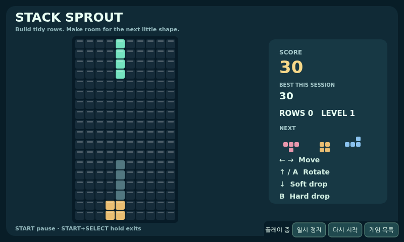
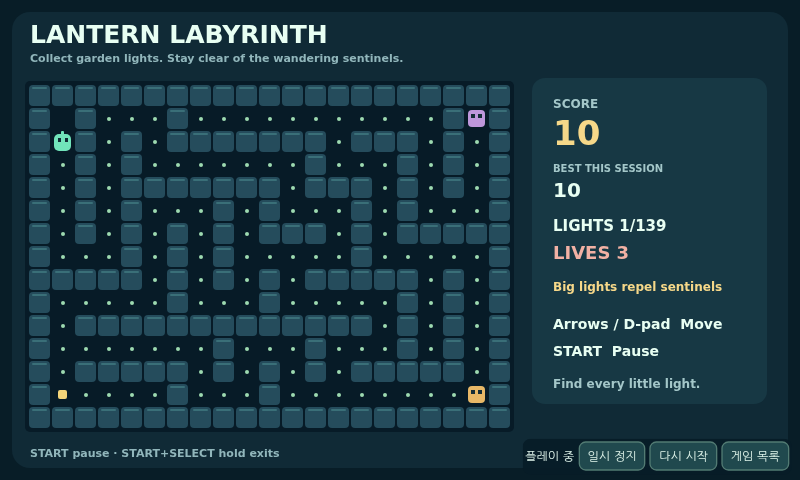
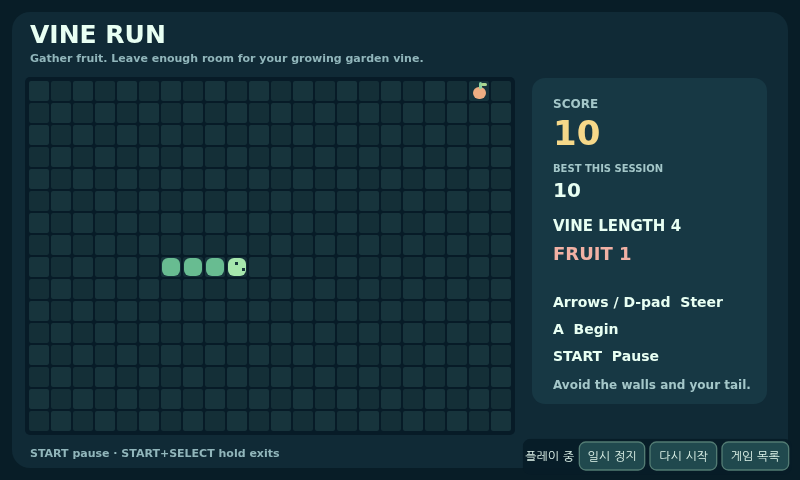

# Issue #37 — BMO 실제 플레이 게임팩 v1

기준은 PR #36의 `0933d9f75b533f3c0c4d285de7b942c201ea3cba`다. 별도 `/home/bgh/BMO_PLAYABLE_GAMES` worktree와 `feature/bmo-playable-games-v1`에서 구현했다. 새 PR의 target은 `feature/bmo-legacy-arm-original-compatible-v1`이며 기존 PR #36·브랜치·checkout을 수정하지 않았다. 최종 SHA와 정확한 해당 SHA의 Actions 링크는 새 PR 완료 기록에 남긴다. main 병합/force push/reset/clean은 하지 않는다.

## 실제 제공하는 게임

| 게임 | 구현한 메커니즘 | 실제 브라우저 검증 |
|---|---|---|
| **Stack Sprout** | 낙하 블록·이동·회전·하드/소프트 드롭·줄 제거·점수·레벨·쌓임 gameover | 키보드와 표준 패드로 점수 증가. 상태 setter 없이 8회 정상 배치 → **1줄 제거·330점**. 쌓임 충돌·pause·재시작 검증. |
| **Lantern Labyrinth** | 자체 미로·수집물·큰 빛 효과·추격자 경로 탐색·목숨·완주/gameover | 키보드/패드 이동으로 빛 수집·점수 증가, 벽 충돌, 추격자와 충돌해 목숨3→0, pause·재시작 검증. |
| **Vine Run** | Snake 조향·먹이·성장·점수·속도 변화·벽/자기 몸 충돌 | 표준 패드로 먹이 수집 → **10점·길이3→4**, 벽 gameover, 역방향 차단, 키보드 재시작·패드 연결 해제 정리 검증. |

세 게임은 자체 JavaScript 엔진과 자체 Canvas 그래픽이며 저장소 MIT 라이선스로 제공한다. ROM·외부 미디어·CDN·제3자 스크립트를 사용하지 않는다. 기존 후보 `BMO_Games_v3.zip`/`BMO_Tetris.html`은 지정 Downloads 경로에 없었으므로 가져오지 않았다. v1 게임은 무음이며 영구 세이브는 제공하지 않는다.

실제 플레이 화면이다. 승인 R10 원본이나 R10 얼굴 스크린샷을 저장소에 추가하지 않고 **자체 게임 화면**만 포함했다.







## 구현 파일과 통합

- `software/bmo_ai/features/games/pack/{engines.js,LICENSE.txt,manifest.json}`: 실제 게임 로직·800×480 UI·라이선스·고정 자산 manifest. 엔진에는 자체 타이머/DOM 입력/네트워크/오디오/장치 접근이 없다.
- `software/bmo_ai/features/games/packaged.py`: manifest pin과 개별 SHA를 확인한 immutable bytes만 제공한다. `PackagedGamesFeature`/웹 runner를 기존 GamesFeature 계약에 연결한다. 브라우저가 현재 launch/generation을 준비했다고 ACK하기 전에는 accepted/executedFalse이고, 이후 실제 소프트웨어 실행으로 기록한다.
- `software/bmo_ai/features/host.py`, `features/server.py`: 검증된 고정 게임 ID에만 기존 real_disabled 제한의 좁은 실행 경로를 연다. 임의 외부 게임·shell·LLM 생성 명령은 계속 차단한다. 기존 ModeManager/AudioFocus/InputRouter를 재사용하고 명령·세대·중복·TTL·watchdog·종료 결과를 관리한다.
- `software/bmo_ai/desktop_web/playable.js`, `desktop.js/index.html/desktop.css`: 같은 Desktop의 게임 메뉴 → 실제 Canvas → 목록 → 원본 R10 경로다. 단일 RAF를 소유하며 pause/gameover/blur/복귀/페이지 종료에서 루프를 멈춘다. snapshot API는 관찰만 제공하며 테스트용 board/score setter를 추가하지 않았다.
- `software/bmo_ai/desktop_app.py`, `desktop_install.py`, `desktop_runtime.py`: `--playable-games` opt-in과 설치 명령 보존, 검증된 자산 제공을 연결한다. 기본 실행/기존 fixture는 그대로다. `--simulate --playable-games`는 대화·장치만 가상화하고 **게임은 실제 엔진**을 실행한다.
- `software/checks/check_playable_games_browser.py`, `tests/test_playable_game_pack.py`, 기존 Desktop fixture/설치 검사, workflow: 실제 플레이·화면·점수·충돌·복귀·cleanup과 SHA/admission/입력 차단 회귀를 검사한다. CI screenshot/result artifact도 업로드한다.
- [짧은 사용법](../../software/PLAYABLE_GAMES_KR.md), `features/games/README.md`: 실행·조작·패드 매핑·원본 보존·검증/복구 안내.

키보드는 별도 bounded game_key 스트림으로 긴 플레이가 일반512요청 장부를 소진하지 않는다. 키보드와 패드의 동시 같은 키는 마지막 소유자가 해제할 때만 release한다. 재시작 버튼은 새 launch ID와 mode generation을 발급하는 기존 launch transaction을 사용하므로 이전 대기 hard-drop이 새 보드에 적용되지 않는다. 페이지 재로드는 과거 입력을 새 엔진에 재생하지 않는다.

## 자동 검증 결과

- 로컬 Python3.13.5 전체: **1,346 PASS**, failure/error/skip0, 88.731초. 새 Python 회귀19개(게임팩18 + 설치 명령 보존1). [unit 결과](PLAYABLE_GAMES_V1_UNIT.json).
- 실제 게임 Playwright: 공개 fixture/R10 **각10개 그룹, 총20 PASS**. 각 게임을 실제 UI에서 키보드·표준 Gamepad API로 플레이하고 점수 증가·pause/restart·충돌/gameover·R10 복귀를 확인했다. [실제 gameplay 결과](PLAYABLE_GAMES_V1_GAMEPLAY.json).
- 기존 offline/Desktop/PTT/camera-media-gamepad/B1 release 브라우저 회귀: 공개/R10/v13.2 **각42개, 총126 PASS**. 새 실제 게임20개와 합쳐 **146 browser checks PASS**. [회귀 결과](PLAYABLE_GAMES_V1_REGRESSION_BROWSER.json).
- Python3.11/3.13 및 실제 게임 browser CI: push 후 정확한 최종 SHA의 Actions를 확인하여 새 PR에 결과와 링크를 기록한다.
- pip check·compile/JS syntax·diff check·보존 경로 diff: PASS.

실제 게임 검사는 정상 공개 API의 `input/update`와 브라우저 키보드·Gamepad API를 사용한다. 가짜 점수·가짜 게임 엔진·보드 조작으로 PASS시키지 않았다. 물리 게임패드 경계만 대체했다. 기존 통합 fixture의 SDK/장치 guard 아래서 PTT/STT/GPT/Fish/카메라/B1 명령 호출0과 owned browser/greeting child 회수를 확인했다.

스크린샷·profile별 결과 JSON은 `artifacts/playable-games/`에 있고, R10 원본 SHA는 검사 전후 `8c3ef98ba0e0645213c95295a24d7353fc2865b5ad9bc85390360c4ec9b78c82`로 일치한다. 공개 CI artifact는 `bmo-playable-games-public`이다. 저장소에는 자체 게임 그림만 올렸다.

## 다음 사용자의 실행·검수

```bash
cd /home/bgh/BMO_PLAYABLE_GAMES
./launch-desktop --simulate --playable-games --usb-gamepad
```

그래픽 세션에서 Esc → 게임 목록 → 게임을 고른다. 키보드 방향키/Z/B/Enter 또는 표준 USB 패드를 사용한다. Esc로 목록, B/얼굴로 돌아가기로 R10에 복귀한다. 기존 live 실행에는 `--playable-games`만 추가할 수 있으며 API 키·카메라·팔 권한을 이 플래그가 바꾸지 않는다.

**실제 브라우저 소프트웨어 플레이는 PASS**, **실제 Pi USB pad·native Qt/물리 LCD 검수는 NOT_RUN**이다. 사용자는 각 게임의 패드 방향/A/B/Start/Select와 종료·R10 복귀만 짧게 확인하면 된다. 게임이 무음이므로 별도 음성/효과음 자산 청취를 완료했다고 주장하지 않는다.

GPIO·서보·USB 포트 제어·RP2040 펌웨어·카메라·유료 Fish/OpenAI API를 실행하지 않았다. 원본 R10·GPT/Fish 정책·카메라·펌웨어·백업에 diff가 없고 별도 서보 차단 스위치 문제를 게임 개발로 우회하지 않는다.

복구는 새 앱을 정상 종료하고 기존 PR #36 checkout/launcher로 돌아가는 것이다. 새 플래그를 빼면 기존 기본 empty/fixture 게임 경로를 사용한다. 기존 아이콘·서비스·worktree·원본 자산을 덮어쓰지 않았으며, 별도 게임 세이브/OS 프로세스/설치한 ROM을 정리할 필요가 없다.
